# Spectra POC — Complete Learning Guide (Phases 1–10)

> **What this document is:** A beginner-friendly guide to understanding the entire Spectra codebase — from high-level architecture down to individual functions and API calls. Written for someone with little to no experience with React, Next.js, JavaScript, or TypeScript.
>
> **Technology versions:** Next.js 16.3.8 · React 19.2.8 · TypeScript 5.x · NextAuth 5.0-beta.32 · Prisma 6.19.3 · Tailwind CSS 4.x
>
> **Generated:** 2026-10-30

---

## Table of Contents

- [Glossary](#glossary)
- [Phase 1: Application Architecture Overview](#phase-1-application-architecture-overview)
- [Phase 2: Folder and File Structure](#phase-2-folder-and-file-structure)
- [Phase 3: JavaScript and TypeScript Fundamentals](#phase-3-javascript-and-typescript-fundamentals)
- [Phase 4: React Components and Layouts](#phase-4-react-components-and-layouts)
- [Phase 5: Functions and Execution Flow](#phase-5-functions-and-execution-flow)
- [Phase 6: APIs and Data Flow](#phase-6-apis-and-data-flow)
- [Phase 7: Authentication and Authorization](#phase-7-authentication-and-authorization)
- [Phase 8: Database Interactions](#phase-8-database-interactions)
- [Phase 9: Complete User Workflows](#phase-9-complete-user-workflows)
- [Phase 10: Debugging and Modification Guide](#phase-10-debugging-and-modification-guide)

---

## Glossary

Terms are introduced progressively. Come back to this as you encounter them.

| Term | Meaning |
|---|---|
| **API** | Application Programming Interface — a way for one piece of software to talk to another. In this app, the browser talks to the server through APIs. |
| **Arrow function** | A shorthand way to write a function: `(x) => x + 1` instead of `function(x) { return x + 1; }` |
| **async/await** | Keywords that let you write code that waits for something (like a database query) without freezing the whole program. |
| **Authentication** | Proving WHO you are (e.g., logging in with a password). |
| **Authorization** | Checking WHAT you're allowed to do (e.g., only ADMINs can access the admin panel). |
| **Callback** | A function you pass to another function, to be called later. |
| **Client Component** | A React component that runs in the browser. Marked with `"use client"` at the top. |
| **Component** | A reusable piece of UI. Like a LEGO brick — you build pages by combining components. |
| **const** | A keyword to declare a variable whose reference cannot be reassigned. |
| **Context (React)** | A way to share data between components without passing it through every level. Like a shared noticeboard. |
| **Cookie** | A small piece of data stored in your browser. Used here to remember that you're logged in. |
| **CRUD** | Create, Read, Update, Delete — the four basic database operations. |
| **CSS** | Cascading Style Sheets — the language that makes web pages look good (colors, fonts, layout). |
| **Destructuring** | Unpacking values from objects or arrays into separate variables: `const { name } = user;` |
| **Endpoint** | A specific URL that an API responds to, like `/api/adoption`. |
| **fetch()** | A built-in browser/server function to make HTTP requests (ask for data or send data). |
| **Hook** | A special React function (starts with `use`) that lets components do things like manage state or fetch data. |
| **HTTP** | HyperText Transfer Protocol — the language browsers and servers use to communicate. |
| **Interface (TypeScript)** | A description of what shape an object must have. Like a form template. |
| **JSON** | JavaScript Object Notation — a text format for structured data. Looks like `{"name": "Alice", "age": 30}`. |
| **JSX/TSX** | A syntax that lets you write HTML-like code inside JavaScript/TypeScript. |
| **JWT** | JSON Web Token — an encoded string stored in a cookie that proves you're logged in. |
| **Layout** | A Next.js file that wraps pages with shared UI (like a navbar or sidebar). |
| **let** | A keyword to declare a variable that CAN be reassigned later. |
| **Middleware** | Code that runs BEFORE a request reaches its destination. Used here to check if you're logged in. |
| **ORM** | Object-Relational Mapping — a tool (Prisma) that lets you talk to a database using JavaScript instead of SQL. |
| **OAuth 2.0** | A standard protocol for "Sign in with..." buttons. Lets you log in via Google, Microsoft, etc. |
| **Page (Next.js)** | A `page.tsx` file inside the `app/` folder. Its folder path becomes the URL. |
| **PostgreSQL** | A powerful open-source relational database. |
| **Prisma** | An ORM tool — translates JavaScript code into SQL database queries. |
| **Promise** | An object representing a value that isn't available yet but will be in the future. |
| **Props** | Data passed from a parent component to a child component. Like function arguments for UI. |
| **Repository pattern** | An architecture pattern where database access is wrapped in a class with a consistent interface. |
| **Route Handler** | A `route.ts` file that defines an API endpoint the server responds to. |
| **Server Component** | A React component that runs on the server (default in Next.js). Cannot use browser-only features. |
| **Session** | Data about the currently logged-in user — stored in a JWT cookie. |
| **State** | Data that a component "remembers" between renders. When state changes, the component re-renders. |
| **Type (TypeScript)** | A label describing what kind of data a variable holds (string, number, object shape, etc.). |

---

# Phase 1: Application Architecture Overview

## 1.1 What Does Spectra Do?

**Simple explanation:** The Singapore government uses digital tools — Zoom for video meetings, Microsoft Teams for chat, and Microsoft Exchange for email. Many government agencies have hundreds or thousands of employees using these tools.

Spectra is a dashboard that answers questions like:
- "How many people are actually using Zoom this month?"
- "Is the Ministry of Health using Teams more or less than last month?"
- "Are we paying for 12,500 Zoom licenses but only 8,000 people are hosting meetings?"

Think of it like a **fitness tracker for government software adoption**. Instead of tracking steps and heart rate, it tracks how many people are using Zoom, how many meetings are happening, and whether AI features are being adopted.

**Technical explanation:** Spectra is a full-stack web application that:
1. **Authenticates** users via GovAuth or Microsoft Entra ID (OAuth 2.0 / OpenID Connect)
2. **Authorizes** access based on per-agency role assignments (ADMIN / EDITOR / VIEWER)
3. **Queries** adoption metrics from PostgreSQL (or optionally Databricks)
4. **Aggregates** data on the server (sums, deltas, trends, adoption rates)
5. **Renders** interactive charts (line, pie, stacked bar) using custom SVG components

## 1.2 Technology Stack

| Technology | Version | Purpose |
|---|---|---|
| **Next.js** | 16.3.8 | Web framework — handles pages (frontend) and API routes (backend) in one project |
| **React** | 19.2.8 | UI library — builds the interactive dashboard from reusable components |
| **TypeScript** | 5.x | Programming language — JavaScript with type checking for fewer bugs |
| **Tailwind CSS** | 4.x | Utility-first CSS framework — styles pages with class names like `bg-blue-600` |
| **NextAuth.js** | 5.0-beta.32 | Authentication library — handles login via Microsoft Entra ID and GovAuth |
| **Prisma** | 6.19.3 | ORM (Object-Relational Mapping) — reads/writes PostgreSQL using JavaScript |
| **PostgreSQL** | external | Relational database — stores users, agencies, roles, and adoption metrics |
| **Databricks** | optional | Cloud data warehouse — alternative data source (stub implementation only) |

## 1.3 What the User Sees

There are three main screens:

| Screen | URL | What it shows |
|---|---|---|
| **Landing Page** | `/` | "Sign In with GovAuth" button. Auto-redirects logged-in users to dashboard. |
| **Dashboard** | `/dashboard/zoom` | KPI cards, line charts, pie charts, bar charts about Zoom usage. Filters for month and agencies. |
| **Admin Panel** | `/admin` | Placeholder for user/role management (ADMIN-only). |

## 1.4 Architecture Diagram

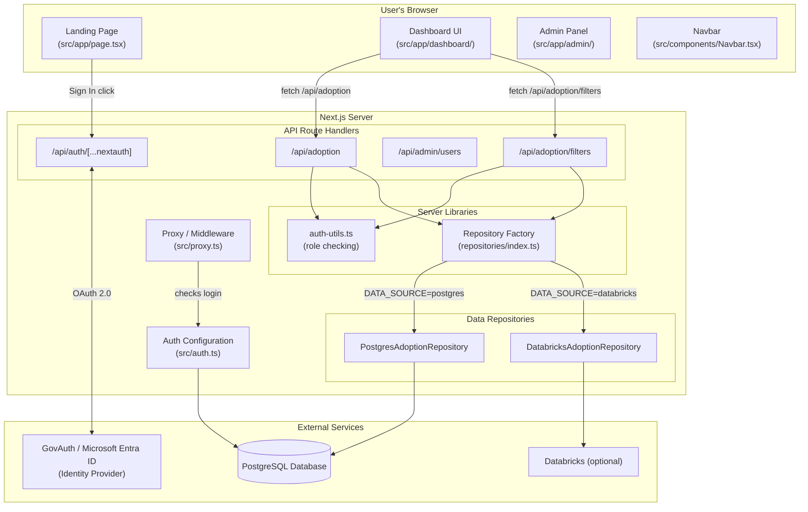

### What each box does

**Browser (runs on YOUR computer):**
- **Landing Page** — First screen. Has a "Sign In" button. If already logged in, auto-redirects to dashboard.
- **Dashboard UI** — Main screen with charts and numbers. Fetches data from the server's API.
- **Admin Panel** — Management screen only ADMIN users can see.
- **Navbar** — Top bar on every page. Shows your name, role badge, and Sign Out button.

**Server (runs on the hosting machine):**
- **Proxy/Middleware** — A "security guard" that checks every request to `/dashboard` or `/admin`: "Is this person logged in?" If not, blocks them.
- **Auth Configuration** — Rules for login: which identity providers to use, how to create JWT tokens, what user info to embed.
- **API Route Handlers** — Server endpoints the browser talks to. The dashboard calls `/api/adoption` to get data.
- **Auth Utils** — Helper functions that check: "What role does this person have?" and "Which agencies can they see?"
- **Repository Factory** — A "switchboard" that picks where data comes from based on the `DATA_SOURCE` environment variable.
- **PostgresAdoptionRepository** — Queries the PostgreSQL database via Prisma.
- **DatabricksAdoptionRepository** — Stub implementation (throws errors; not yet connected).

**External Services (not part of this application):**
- **GovAuth / Microsoft Entra ID** — Identity provider. Verifies your username/password. Spectra never sees your actual password.
- **PostgreSQL Database** — Stores users, agencies, roles, and adoption metric data.
- **Databricks** — Optional alternative data source.

## 1.5 Browser vs. Server

| Runs in the Browser | Runs on the Server |
|---|---|
| React components (UI rendering) | API Route Handlers (`route.ts` files) |
| User interactions (clicks, typing) | Database queries via Prisma |
| SVG chart drawing | Authentication token creation |
| `fetch()` calls to the server API | Role and permission checking |
| Reading the session cookie | Middleware / Proxy checks |
| URL navigation | Data aggregation and calculations |

The browser and server communicate through **HTTP requests** — the browser asks for data, the server processes the request and sends back JSON.

## 1.6 Main User Workflows

1. **Sign in** — User clicks "Sign In with GovAuth" → redirected to identity provider → authenticated → returned to dashboard
2. **View the Zoom dashboard** — Dashboard loads filter options, then Zoom data; renders KPI cards and charts
3. **Filter data** — User picks a month or toggles agencies → dashboard re-fetches data → charts update
4. **Switch period mode** — User toggles monthly/quarterly → server re-aggregates data
5. **Admin management** — Admin views the admin panel (currently placeholder UI)

---

# Phase 2: Folder and File Structure

## 2.1 Why Structure Matters

Think of a project like a filing cabinet. Each **folder** is a drawer, each **file** is a document. If tax documents are in the "recipes" drawer, nobody can find anything.

In Next.js, some file names have **magic meaning**. Put a file called `page.tsx` inside `app/dashboard/` and Next.js automatically makes it the web page at the URL `/dashboard`. The folder structure IS the routing system.

## 2.2 Complete Annotated Structure

```
spectra-poc/
│
├── prisma/                              ← DATABASE DEFINITION
│   ├── schema.prisma                       Blueprint for all database tables
│   ├── seed.ts                             Script to fill database with sample data
│   └── migrations/                         Records of every schema change
│
├── public/                              ← STATIC FILES (served as-is)
│   └── powered-by-govtech.webp            Logo image in dashboard header
│
├── src/                                 ← ALL APPLICATION CODE
│   ├── proxy.ts                            Middleware — security guard for routes
│   ├── auth.ts                             Authentication config — login rules
│   │
│   ├── app/                             ← PAGES AND API ROUTES (Next.js routing)
│   │   ├── layout.tsx                      Root layout — wraps EVERY page
│   │   ├── page.tsx                        Landing page ("/" URL)
│   │   ├── globals.css                     Global styles
│   │   │
│   │   ├── dashboard/                   ← "/dashboard" section
│   │   │   ├── layout.tsx                  Dashboard layout (sidebar, header, filters)
│   │   │   ├── page.tsx                    Redirects /dashboard → /dashboard/zoom
│   │   │   ├── zoom/page.tsx               Zoom analytics page
│   │   │   ├── overview/page.tsx           Executive overview page
│   │   │   ├── exchange/page.tsx           Email analytics page
│   │   │   └── teams/page.tsx              Teams analytics page
│   │   │
│   │   ├── admin/                       ← "/admin" section
│   │   │   ├── layout.tsx                  Server-side ADMIN role guard
│   │   │   └── page.tsx                    Admin panel page
│   │   │
│   │   └── api/                         ← API ROUTES (server-only)
│   │       ├── auth/[...nextauth]/route.ts    All login/logout/callback handling
│   │       ├── adoption/route.ts              Dashboard data endpoint
│   │       ├── adoption/filters/route.ts      Filter options endpoint
│   │       ├── admin/users/route.ts           User list (ADMIN)
│   │       ├── admin/users/[id]/route.ts      Update single user (ADMIN)
│   │       ├── admin/roles/route.ts           Role list (ADMIN)
│   │       ├── admin/agencies/route.ts        Agency list (ADMIN)
│   │       ├── admin/service-mappings/route.ts Service-agency mappings (ADMIN)
│   │       ├── services/route.ts              Service status list
│   │       └── services/latest/route.ts       Latest service status
│   │
│   ├── components/                      ← REUSABLE UI PIECES
│   │   ├── Navbar.tsx                      Top navigation bar
│   │   ├── Providers.tsx                   Session provider wrapper
│   │   ├── LoadingSpinner.tsx              Loading animation
│   │   ├── ErrorDisplay.tsx                Error message with retry button
│   │   │
│   │   ├── adoption/                    ← Dashboard-specific components
│   │   │   ├── DashboardContext.tsx         Shared state for all dashboard pages
│   │   │   ├── AdoptionSidebar.tsx          Left sidebar tab navigation
│   │   │   ├── AdoptionFilters.tsx          Month/agency filter controls
│   │   │   ├── UserMenu.tsx                 User avatar + dropdown menu
│   │   │   ├── DeltaBadge.tsx               "↑ 2.3%" change indicator
│   │   │   ├── ZoomTabContent.tsx           Assembles all Zoom chart sections
│   │   │   ├── ZoomKpiCards.tsx             4 big number cards at top
│   │   │   ├── ZoomWeeklyChart.tsx          Weekly trend line chart
│   │   │   ├── ZoomMeetingInsightPanel.tsx  Meeting/webinar pie + bar charts
│   │   │   ├── ZoomAiAdoptionSection.tsx    AI feature adoption charts
│   │   │   └── ZoomParticipantExperience.tsx User satisfaction chart
│   │   │
│   │   └── charts/                      ← Generic chart components
│   │       ├── index.ts                    Barrel export (re-exports everything)
│   │       ├── LineChart.tsx               SVG line chart with hover tooltips
│   │       ├── PieChart.tsx                SVG pie/donut chart
│   │       ├── StackedBarChart.tsx          SVG stacked bar chart
│   │       ├── KpiCard.tsx                 Generic KPI number card
│   │       ├── ChartTooltip.tsx            Hover tooltip popup
│   │       └── DataTable.tsx               Sortable, paginated table
│   │
│   ├── hooks/                           ← CUSTOM REACT HOOKS
│   │   ├── useAdoptionData.ts              Fetches dashboard data from API
│   │   └── useChartHover.ts                Tracks mouse position for chart tooltips
│   │
│   ├── lib/                             ← SHARED UTILITIES
│   │   ├── prisma.ts                       Database connection singleton
│   │   ├── auth-utils.ts                   Server-side role checking
│   │   ├── client-auth-utils.ts            Browser-side role reading
│   │   ├── api-utils.ts                    API error handling wrapper
│   │   ├── databricks.ts                   Databricks connection helper
│   │   ├── format.ts                       Number formatting ("1.2K", "1,234")
│   │   ├── chart-colors.ts                 Chart color palette
│   │   └── repositories/               ← DATA ACCESS LAYER
│   │       ├── index.ts                    Factory: picks Postgres or Databricks
│   │       ├── adoption-repository.ts      Interface (contract) for both
│   │       ├── postgres-adoption-repository.ts  Postgres queries via Prisma
│   │       ├── databricks-adoption-repository.ts  Stub (not implemented)
│   │       ├── metric-aggregation.ts       Sum/average math helpers
│   │       └── date-utils.ts               Month math (offsets, labels)
│   │
│   ├── types/                           ← TYPE DEFINITIONS
│   │   ├── adoption.ts                     All dashboard data shapes
│   │   ├── services.ts                     Service status types
│   │   └── next-auth.d.ts                  Extends session with role/agency fields
│   │
│   ├── styles/                          ← CUSTOM CSS
│   │   └── adoption.css                    Dashboard-specific styles
│   │
│   └── generated/prisma/               ← AUTO-GENERATED (do not edit)
│       └── ...                             Prisma client code from schema
│
├── package.json                         ← Dependencies and scripts
├── tsconfig.json                        ← TypeScript configuration
├── next.config.ts                       ← Next.js configuration
└── prisma.config.ts                     ← Prisma configuration
```

## 2.3 Next.js Special File Names

| File Name | Magic? | What Next.js Does |
|---|---|---|
| `page.tsx` | **Yes** | Makes the folder a visitable URL. `app/dashboard/zoom/page.tsx` → `/dashboard/zoom` |
| `layout.tsx` | **Yes** | Wraps the page (and child pages) with shared UI. Like a picture frame. |
| `route.ts` | **Yes** | Makes the folder an API endpoint. `app/api/adoption/route.ts` → `/api/adoption` |
| `loading.tsx` | **Yes** | Shown while the page loads (not used in this project). |
| `error.tsx` | **Yes** | Shown when the page crashes (not used in this project). |
| `globals.css` | Convention | Global styles loaded by the root layout. |
| `[id]` folder | **Yes** | Dynamic segment. `app/api/admin/users/[id]/route.ts` matches `/api/admin/users/abc123`. |
| `[...nextauth]` folder | **Yes** | Catch-all route. Matches `/api/auth/signin`, `/api/auth/callback`, etc. |

**Key rule:** `page.tsx` and `route.ts` cannot exist in the same folder. A folder is either a page or an API endpoint, not both.

## 2.4 What Each Folder Convention Means

| Folder | Purpose | Contains |
|---|---|---|
| `app/` | Routing — folder structure = URL structure | Pages, layouts, API routes |
| `components/` | Reusable UI pieces | React components (`.tsx` files) |
| `hooks/` | Reusable logic | Custom React hooks (`use*.ts` files) |
| `lib/` | Shared utilities | Database access, auth helpers, formatting |
| `types/` | Data shape definitions | TypeScript interfaces and types |
| `styles/` | Custom CSS | Stylesheets beyond Tailwind |
| `generated/` | Auto-generated code | Prisma client (do not edit manually) |
| `public/` | Static assets | Images, icons (served as-is at `/filename`) |
| `prisma/` | Database definition | Schema, migrations, seed script |

## 2.5 How Layouts Nest

Layouts wrap pages like Russian nesting dolls. Your project has this nesting:

```
Root Layout (src/app/layout.tsx)
  → Provides: <html>, <body>, Inter font, Providers (session), Navbar
  │
  ├── Landing Page (src/app/page.tsx)
  │     No extra layout — just Root Layout + page content
  │
  ├── Dashboard Layout (src/app/dashboard/layout.tsx)
  │   → Provides: DashboardProvider (shared state), sidebar, header, filters
  │   │
  │   ├── /dashboard/zoom  (zoom/page.tsx)
  │   ├── /dashboard/overview  (overview/page.tsx)
  │   ├── /dashboard/exchange  (exchange/page.tsx)
  │   └── /dashboard/teams  (teams/page.tsx)
  │
  └── Admin Layout (src/app/admin/layout.tsx)
      → Provides: Server-side ADMIN role check (redirects non-admins)
      │
      └── /admin  (page.tsx)
```

When you visit `/dashboard/zoom`, Next.js renders:
```
Root Layout → Dashboard Layout → Zoom Page
```

The Navbar comes from Root Layout. The sidebar comes from Dashboard Layout. The charts come from the Zoom Page.

## 2.6 File Dependency Map

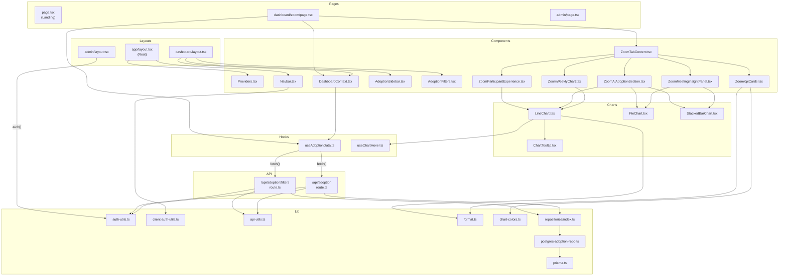

---

# Phase 3: JavaScript and TypeScript Fundamentals

Every concept below is taught using actual code from your project.

## 3.1 Variables: `const` and `let`

**Plain English:** A variable is a labeled box that holds a value. `const` means "this label always points to the same box." `let` means "you can point this label at a different box later."

**Simple example:**
```ts
const name = "Alice";    // name will always be "Alice"
let score = 10;          // score starts at 10
score = 20;              // now score is 20
// name = "Bob";         // ERROR: can't reassign a const
```

**In your project** (`src/lib/format.ts`):
```ts
export const compact = (n: number) =>
  Intl.NumberFormat("en", {
    notation: "compact",
    maximumFractionDigits: 1,
  }).format(n);
```
- `const compact` — declares a variable called `compact` that cannot be reassigned
- It holds a function (we'll cover functions next)
- The `export` keyword makes it available for other files to import

**In your project** (`src/components/adoption/DashboardContext.tsx:36`):
```ts
const [month, setMonth] = useState("2026-10");
```
- `const [month, setMonth]` — declares two variables from a React hook
- Even though `month` is `const`, its VALUE changes via `setMonth` (React manages this internally)

**Common mistake:** Thinking `const` means the value can never change. It means the *variable* can't be *reassigned*. If `const x = [1, 2, 3]`, you can still do `x.push(4)` — you're modifying the array, not reassigning `x`.

## 3.2 Functions and Arrow Functions

**Plain English:** A function is a reusable set of instructions. You give it a name, define what inputs it accepts, write instructions inside, and optionally send back a result.

**Simple example:**
```ts
// Traditional function
function add(a, b) {
  return a + b;
}

// Arrow function (same thing, shorter syntax)
const add = (a, b) => a + b;

// Calling the function
const result = add(3, 5);  // result is 8
```

**In your project** (`src/lib/auth-utils.ts:9-14`):
```ts
export function getEffectiveRole(roleNames: string[]): string {
  return roleNames.reduce(
    (best, name) =>
      (ROLE_PRIORITY[name] ?? 0) > (ROLE_PRIORITY[best] ?? 0) ? name : best,
    "VIEWER"
  );
}
```
- `function getEffectiveRole` — a function called "getEffectiveRole"
- `(roleNames: string[])` — it accepts one input: an array of strings (role names)
- `: string` — it returns a string
- `export` — other files can import it
- The body finds the highest-priority role from the list (we'll unpack the logic later)

**Arrow function in your project** (`src/lib/format.ts:2`):
```ts
export const compact = (n: number) =>
  Intl.NumberFormat("en", { notation: "compact", maximumFractionDigits: 1 }).format(n);
```
- `(n: number)` — accepts one number
- `=>` — the arrow means "this is what the function does"
- No `{}` braces and no `return` keyword — when an arrow function is one expression, the result is automatically returned

**Common mistake:** Forgetting that arrow functions without `{}` auto-return, but with `{}` you must write `return` explicitly.
```ts
const double = (n) => n * 2;        // returns n * 2
const double = (n) => { n * 2; };   // returns undefined! Missing "return"
const double = (n) => { return n * 2; };  // correct with braces
```

## 3.3 Objects

**Plain English:** An object is a collection of labeled values, like a contact card with fields for name, email, and phone.

**Simple example:**
```ts
const user = {
  name: "Alice",
  age: 30,
  role: "ADMIN",
};

console.log(user.name);  // "Alice"
console.log(user.role);  // "ADMIN"
```

**In your project** (`src/auth.ts:18`):
```ts
session: { strategy: "jwt", maxAge: 30 * 60 },
```
- This is an object with two properties: `strategy` (set to `"jwt"`) and `maxAge` (set to `1800`, which is 30 minutes in seconds)

**In your project** (`src/types/adoption.ts:5-15`):
```ts
export interface ProductRecord {
  provisioned: number;
  active: number;
  daily: number;
  emails: number;
  spam: number;
  sessions: number;
  duration: number;
  hosts: number;
  minutes: number;
}
```
- This isn't an actual object — it's a TypeScript **interface** that describes what shape a `ProductRecord` object must have
- Every `ProductRecord` must have all these fields, and they must all be numbers

## 3.4 Arrays

**Plain English:** An array is an ordered list. Like a numbered shopping list — item 1, item 2, item 3.

**Simple example:**
```ts
const fruits = ["apple", "banana", "cherry"];
console.log(fruits[0]);    // "apple" (arrays start at 0)
console.log(fruits.length); // 3
```

**In your project** (`src/lib/repositories/metric-aggregation.ts:4`):
```ts
export const PRODUCTS: ProductId[] = ["exchange", "teams", "zoom"];
```
- An array of three strings
- `ProductId[]` is the TypeScript type — it says "this is an array where every item is a ProductId"

## 3.5 Destructuring

**Plain English:** Destructuring is a shortcut for pulling values out of objects or arrays. Instead of writing `person.name` and `person.age` over and over, you "unpack" them into standalone variables.

**Simple example:**
```ts
// Without destructuring
const user = { name: "Alice", role: "ADMIN" };
const name = user.name;
const role = user.role;

// With destructuring (same result, less typing)
const { name, role } = user;

// Array destructuring
const [first, second] = ["apple", "banana"];
// first = "apple", second = "banana"
```

**In your project** (`src/app/page.tsx:9`):
```ts
const { data: session, status } = useSession();
```
- `useSession()` returns an object like `{ data: {...}, status: "authenticated" }`
- `{ data: session, status }` extracts two values:
  - `data` is renamed to `session` (the `: session` part)
  - `status` keeps its name
- After this line, you have a `session` variable and a `status` variable

**In your project** (`src/components/adoption/DashboardContext.tsx:34`):
```ts
const { months, agencies: allAgencies, loading: filtersLoading } = useAdoptionFilters();
```
- Extracts `months`, renames `agencies` to `allAgencies`, renames `loading` to `filtersLoading`

**Common mistake:** Confusing `{ data: session }` as "set data to session." It's the opposite: it READS the `data` property and stores it in a NEW variable called `session`.

## 3.6 Import and Export

**Plain English:** `export` makes something available to other files. `import` brings something in from another file. Like a library — books are "exported" from the shelves, and you "import" them to your desk.

**Simple example:**
```ts
// In file math.ts
export function add(a, b) { return a + b; }
export const PI = 3.14159;

// In another file
import { add, PI } from "./math";
console.log(add(1, PI));
```

**Two kinds of export in your project:**

Named export (`src/lib/format.ts`):
```ts
export const compact = (n: number) => ...;
export const full = (n: number) => ...;
```
- Imported with braces: `import { compact, full } from "@/lib/format";`

Default export (`src/components/Navbar.tsx`):
```ts
export default function Navbar() { ... }
```
- Imported without braces: `import Navbar from "@/components/Navbar";`
- A file can have only ONE default export

**The `@/` shortcut:** In your project, `@/` is configured in `tsconfig.json` to mean `./src/`. So `@/lib/format` means `./src/lib/format`.

## 3.7 Promises and async/await

**Plain English:** Some operations take time — like asking a database for data or sending a network request. JavaScript doesn't freeze and wait; instead, it gets a "promise" — a placeholder that says "I'll give you the result later."

`async/await` is a way to write code that waits for these promises in a readable way.

**Simple example:**
```ts
// Without async/await (harder to read)
fetch("/api/data")
  .then((response) => response.json())
  .then((data) => console.log(data));

// With async/await (reads top to bottom)
const response = await fetch("/api/data");
const data = await response.json();
console.log(data);
```

The `await` keyword pauses the function until the promise resolves. You can only use `await` inside a function marked `async`.

**In your project** (`src/hooks/useAdoptionData.ts:38-65`):
```ts
const fetchData = useCallback(async () => {
  setLoading(true);
  setError(null);
  try {
    const res = await fetch(`/api/adoption?month=${month}&agencies=${agenciesParam}`);
    if (!res.ok) {
      throw new Error(`Failed to fetch adoption data (HTTP ${res.status})`);
    }
    const json = await res.json();
    setData(json.data);
  } catch (err) {
    const message = err instanceof Error ? err.message : "An unknown error occurred";
    setError(message);
  } finally {
    setLoading(false);
  }
}, [month, agencyCodes]);
```
Step by step:
1. `async () =>` — this function can use `await`
2. `await fetch(...)` — sends a request and WAITS for the response
3. `await res.json()` — parses the response body as JSON and WAITS for it
4. `try/catch` — if anything goes wrong, the `catch` block runs
5. `finally` — runs whether the request succeeded or failed

**Common mistake:** Forgetting `await`. Without it, you get a Promise object instead of the actual data:
```ts
const response = fetch("/api/data");  // response is a Promise, not the data!
const response = await fetch("/api/data");  // response is the actual Response object
```

## 3.8 `map`, `filter`, and `reduce`

**Plain English:**
- `map` — transforms every item in an array (like translating every word in a list)
- `filter` — keeps only items that pass a test (like filtering spam emails)
- `reduce` — combines all items into a single value (like adding up a grocery receipt)

**Simple examples:**
```ts
const numbers = [1, 2, 3, 4, 5];

numbers.map(n => n * 2);            // [2, 4, 6, 8, 10]
numbers.filter(n => n > 3);         // [4, 5]
numbers.reduce((sum, n) => sum + n, 0);  // 15
```

**In your project** (`src/lib/auth-utils.ts:10-14`):
```ts
export function getEffectiveRole(roleNames: string[]): string {
  return roleNames.reduce(
    (best, name) =>
      (ROLE_PRIORITY[name] ?? 0) > (ROLE_PRIORITY[best] ?? 0) ? name : best,
    "VIEWER"
  );
}
```
This `reduce` starts with `"VIEWER"` and compares each role name against the current best. If the new role has higher priority, it becomes the new best. The final result is the highest-priority role.

**In your project** (`src/hooks/useAdoptionData.ts:142`):
```ts
setMonths(json.data.months);
```
And later, those months are used with `map` in `AdoptionFilters.tsx:88`:
```ts
{availableMonths.map((m) => (
  <option key={m.value} value={m.value}>{m.label}</option>
))}
```
This transforms each month object into an `<option>` HTML element for a dropdown.

## 3.9 Optional Chaining (`?.`)

**Plain English:** Safely access properties of something that might be `null` or `undefined`. Without it, accessing a property of `null` crashes your program.

**Simple example:**
```ts
const user = null;
// user.name          // CRASH: Cannot read property 'name' of null
user?.name            // undefined (no crash)
```

**In your project** (`src/components/Navbar.tsx:54`):
```ts
{session.user?.name || session.user?.email}
```
- If `session.user` doesn't have a `name`, try `email` instead
- The `?.` prevents a crash if `user` were somehow null

## 3.10 Spread Syntax (`...`)

**Plain English:** The three dots `...` "spread" an array or object's contents into a new one. Like pouring the contents of one box into another box.

**Simple example:**
```ts
const a = [1, 2, 3];
const b = [...a, 4, 5];  // [1, 2, 3, 4, 5]

const user = { name: "Alice", role: "VIEWER" };
const updated = { ...user, role: "ADMIN" };  // { name: "Alice", role: "ADMIN" }
```

**In your project** (`src/lib/repositories/postgres-adoption-repository.ts:139`):
```ts
return { ...(averaged as unknown as ProductRecord), adoption };
```
- Takes all properties from `averaged` and adds an `adoption` property
- Creates a new object rather than modifying the original

## 3.11 TypeScript Interfaces and Types

**Plain English:** TypeScript lets you describe what shape your data must have. An interface is like a form template — it says "this object must have these fields with these types."

**Simple example:**
```ts
interface User {
  name: string;
  age: number;
  isAdmin: boolean;
}

const alice: User = { name: "Alice", age: 30, isAdmin: true };
// const bad: User = { name: "Bob" };  // ERROR: missing age and isAdmin
```

**In your project** (`src/types/adoption.ts:71-73`):
```ts
export type PeriodMode = "month" | "quarter";
```
- `type` (similar to `interface`) defines a type
- `"month" | "quarter"` means the value can ONLY be one of these two strings
- The `|` means "or"

**In your project** (`src/types/adoption.ts:95-101`):
```ts
export interface ZoomKpiData {
  usersOnboarded: number;
  totalWogUsers: number;
  activeUsers: ZoomKpiMetric;
  activeHosts: ZoomKpiHostMetric;
}
```
- `activeUsers` isn't just a number — it's a `ZoomKpiMetric`, which is another interface
- Interfaces can reference other interfaces, building up complex shapes from simple ones

## 3.12 Generics

**Plain English:** Generics let you write code that works with ANY type, while still being type-safe. Like a box that says "I hold one type of thing — you tell me which type when you use me."

**Simple example:**
```ts
// Without generics: only works with numbers
function firstItem(arr: number[]): number {
  return arr[0];
}

// With generics: works with ANY type
function firstItem<T>(arr: T[]): T {
  return arr[0];
}

firstItem<string>(["a", "b"]);  // returns "a" (type: string)
firstItem<number>([1, 2, 3]);   // returns 1 (type: number)
```

**In your project** (`src/components/charts/DataTable.tsx:23`):
```ts
export default function DataTable<T>({
  columns,
  rows,
  rowKey,
  ...
}: DataTableProps<T>) {
```
- `<T>` means "T is a placeholder for whatever type of data the table holds"
- The same DataTable component can display rows of agencies, users, or any other data type
- TypeScript figures out `T` from how you call the component

## 3.13 Error Handling with try/catch

**Plain English:** `try/catch` is like a safety net. Code inside `try` runs normally. If anything goes wrong (an "exception"), execution jumps to `catch` instead of crashing the program.

**Simple example:**
```ts
try {
  const data = JSON.parse("not valid json");
} catch (error) {
  console.log("Something went wrong:", error.message);
}
// Program continues running normally
```

**In your project** (`src/lib/api-utils.ts:8-27`):
```ts
export function withErrorHandling(handler: ApiHandler): ApiHandler {
  return async (request) => {
    try {
      return await handler(request);
    } catch (error) {
      if (error instanceof AuthError) {
        return NextResponse.json({ error: error.message }, { status: error.status });
      }
      return NextResponse.json({ error: "Internal server error" }, { status: 500 });
    }
  };
}
```
- Every API route is wrapped in this function
- If the handler throws an `AuthError` (like "not logged in"), it returns a 401 or 403 HTTP response
- If any other error occurs, it returns a generic 500 error
- This prevents the server from crashing on unexpected errors

---

# Phase 4: React Components and Layouts

## 4.1 What is a Component?

**Plain English:** A component is a reusable piece of the user interface. Think of LEGO bricks — a button is a brick, a card is a brick, a chart is a brick. You combine bricks to build a page.

**Technical:** A component is a JavaScript function that returns JSX (HTML-like syntax). React calls this function and turns the JSX into actual HTML that the browser displays.

**Simple example:**
```tsx
function Greeting({ name }) {
  return <h1>Hello, {name}!</h1>;
}

// Usage:
<Greeting name="Alice" />
// Renders: <h1>Hello, Alice!</h1>
```

## 4.2 What is JSX/TSX?

**Plain English:** JSX lets you write HTML inside JavaScript. TSX is the same thing but for TypeScript. It looks like HTML but it's actually JavaScript under the hood.

**Key differences from HTML:**
- Use `className` instead of `class`
- Use `{}` to insert JavaScript expressions: `<p>{user.name}</p>`
- Self-closing tags require a slash: `` not ``
- Event handlers use camelCase: `onClick` not `onclick`

**In your project** (`src/components/LoadingSpinner.tsx`):
```tsx
export default function LoadingSpinner() {
  return (
    <div className="flex flex-col items-center justify-center py-20">
      <div className="w-12 h-12 border-4 border-blue-200 border-t-blue-600 rounded-full animate-spin mb-4" />
      <p className="text-gray-500 text-lg">Loading service data...</p>
    </div>
  );
}
```
- This looks like HTML but it's JSX inside a JavaScript function
- The `className` strings are Tailwind CSS utility classes that control appearance
- The function returns this JSX, and React renders it into real HTML

## 4.3 Props

**Plain English:** Props are data passed from a parent component to a child component. Like passing arguments to a function — the parent decides WHAT to display, the child decides HOW to display it.

**In your project** (`src/components/ErrorDisplay.tsx:9-12`):
```tsx
interface ErrorDisplayProps {
  message: string;
  onRetry: () => void;
}

export default function ErrorDisplay({ message, onRetry }: ErrorDisplayProps) {
  return (
    <div>
      <p>{message}</p>
      <button onClick={onRetry}>Try Again</button>
    </div>
  );
}
```
- `ErrorDisplayProps` defines what props this component accepts: a `message` string and an `onRetry` function
- The parent passes these in: `<ErrorDisplay message="Connection failed" onRetry={fetchData} />`
- The component uses `{message}` to display the text and `onClick={onRetry}` to handle the button click

## 4.4 State

**Plain English:** State is data that a component "remembers" between renders. When state changes, the component re-renders with the new data — the UI updates automatically.

**In your project** (`src/components/adoption/AdoptionFilters.tsx:36-38`):
```tsx
const [dropdownOpen, setDropdownOpen] = useState(false);
const [search, setSearch] = useState("");
```
- `useState(false)` creates a state variable starting at `false`
- Returns a pair: `[currentValue, functionToChangeIt]`
- `dropdownOpen` is the current value (`false` initially)
- `setDropdownOpen` is the function to change it
- When `setDropdownOpen(true)` is called, React re-renders the component with `dropdownOpen = true`
- This is how the agency dropdown opens and closes

## 4.5 Hooks

**Plain English:** Hooks are special functions (always start with `use`) that give components extra abilities like remembering state, running code when something changes, or sharing data.

**The hooks used in your project:**

| Hook | Source | Purpose |
|---|---|---|
| `useState` | React | Remember a value and re-render when it changes |
| `useEffect` | React | Run code when the component loads or when dependencies change |
| `useCallback` | React | Memoize a function so it doesn't get recreated every render |
| `useRef` | React | Hold a reference to a DOM element or a mutable value without causing re-renders |
| `useContext` | React | Read shared data from a React Context |
| `useMemo` | React | Cache an expensive calculation so it only re-runs when inputs change |
| `useSession` | NextAuth | Get the current user's login session |
| `useRouter` | Next.js | Navigate to different pages programmatically |
| `usePathname` | Next.js | Get the current URL path |
| `useAdoptionData` | Custom | Fetch adoption overview data from the API |
| `useZoomData` | Custom | Fetch Zoom tab data from the API |
| `useAdoptionFilters` | Custom | Fetch available months and agencies |
| `useChartHover` | Custom | Track mouse position for chart tooltips |
| `useRole` | Custom | Read the current user's role from the session |

## 4.6 Client Components vs. Server Components

**Plain English:** By default, Next.js components run on the SERVER — they generate HTML there and send it to the browser. But some things (clicking buttons, hovering over charts, managing dropdowns) can only happen in the BROWSER. For those, you add `"use client"` at the top of the file.

**Rule:** If a component uses `useState`, `useEffect`, `onClick`, or any browser-only API, it MUST be a Client Component.

| | Server Component | Client Component |
|---|---|---|
| **Runs where** | Server | Browser |
| **Marker** | Nothing (default) | `"use client"` at top of file |
| **Can use** | `async/await`, database access, file system | `useState`, `useEffect`, `onClick`, browser APIs |
| **Cannot use** | `useState`, `useEffect`, `onClick` | Direct database access |
| **Example in project** | `admin/layout.tsx`, `dashboard/page.tsx` | `page.tsx` (landing), all components in `components/` |

**In your project:**

Server Component (`src/app/admin/layout.tsx`):
```tsx
// No "use client" — this runs on the server
import { auth } from "@/auth";
import { redirect } from "next/navigation";

export default async function AdminLayout({ children }) {
  const session = await auth();        // Can await directly
  if (!session) redirect("/");         // Server-side redirect
  if (session.user.role !== "ADMIN") redirect("/dashboard");
  return <>{children}</>;
}
```

Client Component (`src/app/page.tsx`):
```tsx
"use client";  // This runs in the browser

import { useSession, signIn } from "next-auth/react";
import { useRouter } from "next/navigation";
import { useEffect } from "react";

export default function HomePage() {
  const { data: session, status } = useSession();  // Hook = needs "use client"
  const router = useRouter();

  useEffect(() => {                                // Effect = needs "use client"
    if (session) router.push("/dashboard");
  }, [session, router]);
  // ...
}
```

## 4.7 Component Hierarchy

This diagram shows which components render which other components:

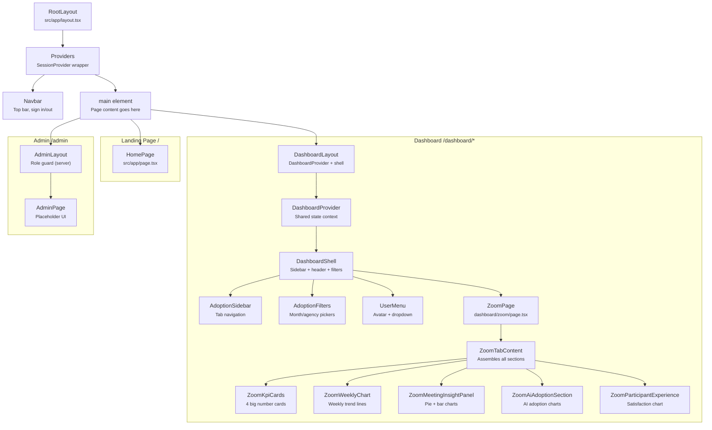

## 4.8 Component Reference Table

| Component | File | Purpose | Parent | Props | State | APIs Called |
|---|---|---|---|---|---|---|
| **RootLayout** | `src/app/layout.tsx` | Wraps entire app with HTML, font, session, navbar | Next.js | `children` | None | None |
| **Providers** | `src/components/Providers.tsx` | Provides NextAuth session to all children | RootLayout | `children` | None | None |
| **Navbar** | `src/components/Navbar.tsx` | Top bar with nav links, role badge, sign out | RootLayout | None | Uses `useSession`, `useRole` | None |
| **HomePage** | `src/app/page.tsx` | Landing page with sign-in button | RootLayout | None | `useSession`, `useRouter` | None |
| **DashboardLayout** | `src/app/dashboard/layout.tsx` | Dashboard shell with sidebar, header, filters | RootLayout | `children` | Via DashboardProvider | `/api/adoption/filters` |
| **DashboardContext** | `src/components/adoption/DashboardContext.tsx` | Shared state for month, agencies, period mode | DashboardLayout | `children` | `month`, `selectedAgencies`, `periodMode`, `activityType` | Via `useAdoptionFilters` |
| **AdoptionSidebar** | `src/components/adoption/AdoptionSidebar.tsx` | Left tab navigation | DashboardShell | `activeTab`, `onTabChange` | None | None |
| **AdoptionFilters** | `src/components/adoption/AdoptionFilters.tsx` | Month picker, agency dropdown, period toggle | DashboardShell | `month`, `onMonthChange`, `selectedAgencies`, etc. | `dropdownOpen`, `search` | None |
| **UserMenu** | `src/components/adoption/UserMenu.tsx` | Avatar with dropdown showing name/role/agencies | DashboardShell | None | `open` (dropdown), `useSession`, `useRole` | None |
| **ZoomPage** | `src/app/dashboard/zoom/page.tsx` | Fetches Zoom data and renders ZoomTabContent | DashboardShell | None | Via `useZoomData` | `/api/adoption?tab=zoom` |
| **ZoomTabContent** | `src/components/adoption/ZoomTabContent.tsx` | Assembles KPIs, charts, tables | ZoomPage | `data`, `periodMode`, `activityType`, `onActivityTypeChange` | None | None |
| **ZoomKpiCards** | `src/components/adoption/ZoomKpiCards.tsx` | 4 KPI cards (onboarded, WOG, active, hosts) | ZoomTabContent | `kpis` (ZoomKpiData) | None | None |
| **ZoomWeeklyChart** | `src/components/adoption/ZoomWeeklyChart.tsx` | Weekly trend line chart | ZoomTabContent | `weeklyData`, `licenseThreshold` | None | None |
| **ZoomMeetingInsightPanel** | `src/components/adoption/ZoomMeetingInsightPanel.tsx` | Meeting/webinar pie or bar chart | ZoomTabContent | `data`, `activityType`, `onActivityTypeChange`, `periodMode` | None | None |
| **ZoomAiAdoptionSection** | `src/components/adoption/ZoomAiAdoptionSection.tsx` | AI adoption KPIs + trend + features charts | ZoomTabContent | `data`, `periodMode` | None | None |
| **ZoomParticipantExperience** | `src/components/adoption/ZoomParticipantExperience.tsx` | Participant satisfaction line chart | ZoomTabContent | `data` (ZoomExperiencePoint[]) | None | None |
| **LineChart** | `src/components/charts/LineChart.tsx` | Generic SVG line chart with hover | Various | `labels`, `series`, `threshold`, etc. | Via `useChartHover` | None |
| **PieChart** | `src/components/charts/PieChart.tsx` | Generic SVG pie chart with hover | Various | `segments` | `hover` | None |
| **StackedBarChart** | `src/components/charts/StackedBarChart.tsx` | Generic SVG stacked bar chart | Various | `bars` | `hover` | None |
| **DeltaBadge** | `src/components/adoption/DeltaBadge.tsx` | "↑ 2.3% vs previous period" indicator | KPI cards | `value`, `suffix` | None | None |
| **AdminLayout** | `src/app/admin/layout.tsx` | Server-side ADMIN guard | RootLayout | `children` | None (server component) | `auth()` |
| **AdminPage** | `src/app/admin/page.tsx` | Admin panel placeholder | AdminLayout | None | `useSession` | None |
| **LoadingSpinner** | `src/components/LoadingSpinner.tsx` | Spinning circle animation | Various | None | None | None |
| **ErrorDisplay** | `src/components/ErrorDisplay.tsx` | Error message with retry | Various | `message`, `onRetry` | None | None |

---

# Phase 5: Functions and Execution Flow

## 5.1 Key Functions Inventory

### Authentication Functions

| Function | File | Runs Where | Purpose |
|---|---|---|---|
| `auth()` | `src/auth.ts` | Server | Returns the current user's session (from JWT cookie) |
| `signIn("govauth")` | NextAuth library | Browser | Starts the OAuth login flow |
| `signOut()` | NextAuth library | Browser | Destroys the session and redirects |
| `useSession()` | NextAuth library | Browser | React hook — reads session in components |
| `getEffectiveRole()` | `src/lib/auth-utils.ts` | Server | Given role names, returns the highest-priority one |
| `requireRole()` | `src/lib/auth-utils.ts` | Server | Throws an error if user doesn't have the required role |
| `authenticateAndScope()` | `src/lib/auth-utils.ts` | Server | Checks login + returns which agencies the user can see |
| `scopeAgencies()` | `src/lib/auth-utils.ts` | Server | Filters requested agencies to only those the user is allowed |
| `useRole()` | `src/lib/client-auth-utils.ts` | Browser | Hook — returns role, isAdmin, agencyCodes from session |

### Data Fetching Functions

| Function | File | Runs Where | Purpose |
|---|---|---|---|
| `useAdoptionFilters()` | `src/hooks/useAdoptionData.ts` | Browser | Fetches available months and agencies from `/api/adoption/filters` |
| `useAdoptionData()` | `src/hooks/useAdoptionData.ts` | Browser | Fetches overview data from `/api/adoption` |
| `useZoomData()` | `src/hooks/useAdoptionData.ts` | Browser | Fetches Zoom data from `/api/adoption?tab=zoom` |
| `withErrorHandling()` | `src/lib/api-utils.ts` | Server | Wraps API route handlers with try/catch |
| `getAdoptionRepository()` | `src/lib/repositories/index.ts` | Server | Returns the correct repository (Postgres or Databricks) |

### Data Processing Functions

| Function | File | Purpose |
|---|---|---|
| `fetchMetrics()` | `postgres-adoption-repository.ts` | Queries AdoptionMetric table for given months + agencies |
| `groupByProduct()` | `postgres-adoption-repository.ts` | Groups metric rows by product (exchange/teams/zoom) |
| `sumProductRecords()` | `metric-aggregation.ts` | Sums all numeric fields across an array of records |
| `computeTotals()` | `metric-aggregation.ts` | Computes cross-product totals (active, sessions, adoption rate) |
| `monthOffset()` | `date-utils.ts` | Converts "2026-10" to a numeric offset from the base date |
| `offsetToKey()` | `date-utils.ts` | Converts a numeric offset back to "YYYY-MM" |
| `compact()` | `format.ts` | Formats numbers as "1.2K", "45.3K" |
| `full()` | `format.ts` | Formats numbers as "1,234", "45,321" |

### UI Interaction Functions

| Function | File | Purpose |
|---|---|---|
| `useChartHover()` | `src/hooks/useChartHover.ts` | Tracks which data point the mouse is nearest to |
| `toggleAgency()` | `DashboardContext.tsx` | Adds/removes an agency from the selection |
| `selectAllAgencies()` | `DashboardContext.tsx` | Selects all agencies |
| `clearAllAgencies()` | `DashboardContext.tsx` | Deselects all agencies |
| `resetFilters()` | `DashboardContext.tsx` | Resets month, period, activity type, and agencies to defaults |

## 5.2 Execution Walkthrough: Loading the Dashboard

Here's what happens step by step when a user navigates to `/dashboard/zoom`:

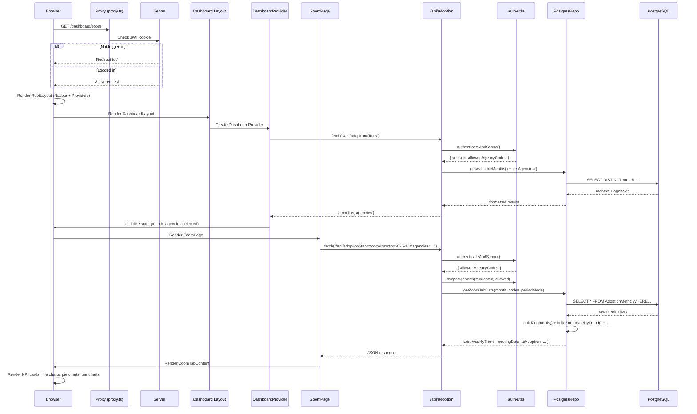

### Step-by-step narrative:

1. **Browser requests `/dashboard/zoom`** — The proxy checks the JWT cookie. If not logged in, redirects to `/`.

2. **Root Layout renders** — Loads the Inter font, wraps everything in `<Providers>` (which provides the session), and renders the `<Navbar>`.

3. **Dashboard Layout renders** — Creates a `DashboardProvider` (shared state context) and the shell (sidebar, header, filters).

4. **DashboardProvider initializes** — Calls `useAdoptionFilters()` which fetches `GET /api/adoption/filters`. The server:
   - Checks authentication
   - Queries the database for available months and agencies
   - Returns them as JSON

5. **State initializes** — The DashboardProvider sets `month = "2026-10"` and selects all agencies.

6. **ZoomPage renders** — Calls `useZoomData(month, selectedAgencies, periodMode)` which fetches `GET /api/adoption?tab=zoom&month=2026-10&agencies=...`. The server:
   - Checks authentication
   - Scopes agencies to what the user is allowed to see
   - Queries the AdoptionMetric table
   - Builds KPIs, weekly trends, meeting data, AI adoption data, experience data
   - Returns everything as one JSON object

7. **Charts render** — `ZoomTabContent` passes data to child components, which render SVG charts.

## 5.3 Execution Walkthrough: Changing the Month Filter

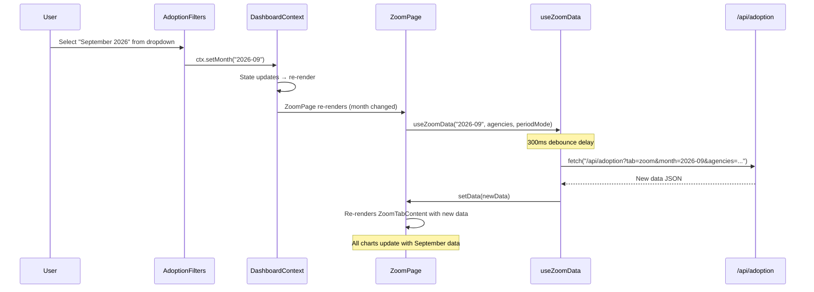

Key detail: the `useZoomData` hook has a **300ms debounce**. If the user quickly changes multiple filters, it waits 300ms after the last change before making the API call. This prevents flooding the server with requests.

## 5.4 Execution Walkthrough: Sign In

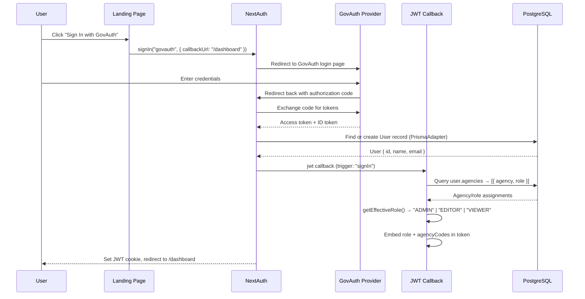

After sign-in, the JWT cookie contains:
- User ID, name, email
- Effective role (ADMIN/EDITOR/VIEWER)
- Agency codes the user belongs to
- Agency names

This data is read on every page load WITHOUT querying the database again — it's all in the cookie.

---

# Phase 6: APIs and Data Flow

## 6.1 What is an API?

**Plain English:** An API (Application Programming Interface) is a way for two pieces of software to talk to each other. In a web app, the browser (frontend) talks to the server (backend) through APIs.

Think of a restaurant: you (the browser) give your order (request) to the waiter (API). The waiter takes it to the kitchen (server). The kitchen prepares the food (processes the request, queries the database). The waiter brings back your meal (response).

## 6.2 What is an HTTP Request?

Every API call is an HTTP request. It has:

| Part | What it is | Example |
|---|---|---|
| **Method** | What action to perform | GET (read), POST (create), PATCH (update), DELETE (remove) |
| **URL** | Where to send it | `/api/adoption?month=2026-10&agencies=GTA,MOH` |
| **Headers** | Metadata | Cookies (for authentication), Content-Type |
| **Body** | Data to send (POST/PATCH only) | `{"agencies": [{"agencyId": "abc", "roleId": "xyz"}]}` |

The server responds with:

| Part | What it is | Example |
|---|---|---|
| **Status Code** | Did it work? | 200 (OK), 401 (not logged in), 403 (forbidden), 500 (server error) |
| **Body** | The data | `{"success": true, "data": {...}}` |

## 6.3 What is JSON?

**Plain English:** JSON (JavaScript Object Notation) is a text format for structured data. It's how the browser and server exchange information.

```json
{
  "success": true,
  "data": {
    "kpis": {
      "usersOnboarded": 67435,
      "activeUsers": { "value": 43210, "delta": 2.3 }
    }
  },
  "queriedAt": "2026-10-30T14:23:00.000Z"
}
```

## 6.4 What `fetch()` Does

`fetch()` is the built-in function for making HTTP requests:

```ts
// 1. Send the request and wait for headers
const response = await fetch("/api/adoption?month=2026-10");

// 2. Check if it succeeded
if (!response.ok) {
  throw new Error(`HTTP error: ${response.status}`);
}

// 3. Read and parse the body as JSON
const json = await response.json();

// 4. Use the data
console.log(json.data);
```

## 6.5 Complete API Inventory

### `GET /api/adoption/filters`

| Property | Value |
|---|---|
| **Endpoint** | `/api/adoption/filters` |
| **Method** | GET |
| **Caller** | `useAdoptionFilters()` in `src/hooks/useAdoptionData.ts:139` |
| **Handler** | `src/app/api/adoption/filters/route.ts` |
| **Authentication** | Required — calls `authenticateAndScope()` |
| **Request data** | None (no query params needed) |
| **Processing** | Queries distinct months from AdoptionMetric table; queries agencies filtered by user's allowed codes |
| **Database** | `SELECT DISTINCT month FROM AdoptionMetric`; `SELECT * FROM Agency WHERE code IN (...)` |
| **Response** | `{ success: true, data: { months: [{value, label}], agencies: [{id, name, code}] } }` |
| **UI impact** | Populates the month dropdown and agency checkboxes in AdoptionFilters |

### `GET /api/adoption` (overview mode)

| Property | Value |
|---|---|
| **Endpoint** | `/api/adoption?month=2026-10&agencies=GTA,MOH` |
| **Method** | GET |
| **Caller** | `useAdoptionData()` in `src/hooks/useAdoptionData.ts:28` |
| **Handler** | `src/app/api/adoption/route.ts` |
| **Authentication** | Required — calls `authenticateAndScope()` |
| **Request data** | Query params: `month`, `agencies` (comma-separated codes) |
| **Processing** | Fetches metrics for current + previous month + 6-month trend. Computes totals, deltas, per-agency breakdown. |
| **Database** | `SELECT * FROM AdoptionMetric WHERE month IN (...) AND agencyCode IN (...)` |
| **Response** | `{ success: true, data: { currentTotals, previousTotals, trend[], agencies[], topAgency } }` |
| **UI impact** | Renders overview KPI cards, trend chart, agency table |

### `GET /api/adoption?tab=zoom` (Zoom mode)

| Property | Value |
|---|---|
| **Endpoint** | `/api/adoption?tab=zoom&month=2026-10&agencies=GTA,MOH&periodMode=month` |
| **Method** | GET |
| **Caller** | `useZoomData()` in `src/hooks/useAdoptionData.ts:85` |
| **Handler** | `src/app/api/adoption/route.ts` |
| **Authentication** | Required — calls `authenticateAndScope()` |
| **Request data** | Query params: `tab=zoom`, `month`, `agencies`, `periodMode` (month/quarter) |
| **Processing** | Fetches a wide range of months. Builds KPIs (active users, hosts, utilization), weekly trends, meeting data (pie/bar), AI adoption (trend + features), participant experience. |
| **Database** | Single query: `SELECT * FROM AdoptionMetric WHERE month IN (many months) AND agencyCode IN (...)` |
| **Response** | `{ success: true, data: { kpis, weeklyTrend, meetingData, aiAdoption, participantExperience, licenseThreshold } }` |
| **UI impact** | Renders entire Zoom dashboard: 4 KPI cards, weekly chart, meeting chart, AI section, experience chart |

### `GET /api/admin/users`

| Property | Value |
|---|---|
| **Endpoint** | `/api/admin/users?page=1&limit=20&search=alice` |
| **Method** | GET |
| **Caller** | Admin panel (not yet implemented in UI) |
| **Handler** | `src/app/api/admin/users/route.ts` |
| **Authentication** | ADMIN only — calls `requireRole("ADMIN")` |
| **Request data** | Query params: `page`, `limit`, `search` |
| **Processing** | Paginated user list with role and agency info |
| **Database** | `SELECT * FROM User (with agencies, roles) WHERE name/email LIKE search` |
| **Response** | `{ users: [{id, name, email, role, agencies}], total, page, limit }` |

### `PATCH /api/admin/users/[id]`

| Property | Value |
|---|---|
| **Endpoint** | `/api/admin/users/:id` |
| **Method** | PATCH |
| **Caller** | Admin panel (not yet implemented in UI) |
| **Handler** | `src/app/api/admin/users/[id]/route.ts` |
| **Authentication** | ADMIN only |
| **Request data** | Body: `{ agencies: [{ agencyId, roleId }] }` |
| **Processing** | Deletes all existing UserAgency records for this user, then creates new ones |
| **Database** | `DELETE FROM UserAgency WHERE userId=id`, then `INSERT INTO UserAgency (...)` |
| **Response** | Updated user with new roles and agencies |

### `GET /api/auth/[...nextauth]/*`

| Property | Value |
|---|---|
| **Endpoint** | `/api/auth/signin`, `/api/auth/callback/govauth`, `/api/auth/signout`, etc. |
| **Method** | GET and POST |
| **Handler** | `src/app/api/auth/[...nextauth]/route.ts` → delegates to NextAuth |
| **Processing** | Handles the entire OAuth flow: redirects, token exchange, session creation |
| **Response** | Redirects, sets/clears cookies |

## 6.6 Data Flow: Browser → Server → Database → Browser

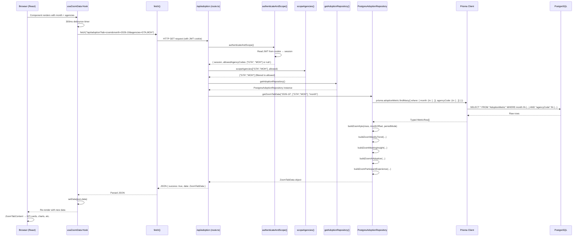

## 6.7 Agency Scoping: How Data Access is Restricted

A critical security feature: non-ADMIN users can only see data for agencies they've been assigned to.

```
User requests: agencies=GTA,MOH,MFA
User is assigned to: GTA, MOH only

scopeAgencies(["GTA","MOH","MFA"], ["GTA","MOH"])
  → Returns: ["GTA","MOH"]
  → MFA is silently removed

If user is ADMIN:
  allowedAgencyCodes = null (means "all agencies")
  scopeAgencies(["GTA","MOH","MFA"], null)
  → Returns: ["GTA","MOH","MFA"] (no filtering)
```

This happens in `src/lib/auth-utils.ts:61-72`:
```ts
export function scopeAgencies(
  requestedCodes: string[],
  allowedCodes: string[] | null
): string[] {
  if (allowedCodes === null) return requestedCodes;       // ADMIN: no filter
  if (requestedCodes.length === 0) return allowedCodes;   // No request: return all allowed
  return requestedCodes.filter((code) => allowedCodes.includes(code));  // Intersection
}
```

## 6.8 The Repository Pattern

Your project uses a design pattern called the **Repository Pattern** to separate "how we get data" from "what we do with it."

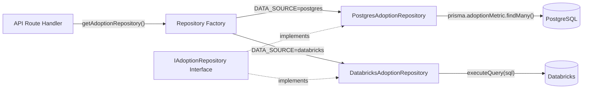

**Why this pattern exists:**
- The API routes don't care WHERE data comes from
- To switch from PostgreSQL to Databricks, you only change the `DATA_SOURCE` environment variable
- Both repositories implement the same interface (`IAdoptionRepository`), so they're interchangeable
- The Databricks implementation is currently a stub — it throws errors saying "not yet available"

The interface (`src/lib/repositories/adoption-repository.ts`) defines the contract:
```ts
export interface IAdoptionRepository {
  getAdoptionOverview(month, agencyCodes): Promise<AdoptionOverviewData>;
  getZoomTabData(month, agencyCodes, periodMode): Promise<ZoomTabData>;
  getAvailableMonths(): Promise<AdoptionMonth[]>;
  getAgencies(allowedCodes?): Promise<AgencyOption[]>;
}
```

Both `PostgresAdoptionRepository` and `DatabricksAdoptionRepository` must implement all four methods.

## 6.9 How Server Data Becomes Charts

The transformation pipeline from database to pixels:

```
Database rows (raw)
    │
    ▼
PostgresAdoptionRepository (aggregates, calculates deltas, builds trends)
    │
    ▼
JSON response (structured: kpis, weeklyTrend, meetingData, etc.)
    │
    ▼
useZoomData hook (stores in React state)
    │
    ▼
ZoomTabContent (passes to child components via props)
    │
    ├─→ ZoomKpiCards → renders 4 number cards with DeltaBadge
    ├─→ ZoomWeeklyChart → LineChart component → SVG polylines
    ├─→ ZoomMeetingInsightPanel → PieChart or StackedBarChart → SVG paths/rects
    ├─→ ZoomAiAdoptionSection → LineChart + PieChart/StackedBarChart
    └─→ ZoomParticipantExperience → LineChart with dual axes
```

Each chart component receives pre-processed data as props and converts it to SVG elements (lines, circles, rectangles, arcs) that the browser draws on screen. The chart components don't know anything about adoption metrics — they just draw whatever numbers they receive.

---

## Summary: What Happens When You Visit the Dashboard

1. **Proxy checks** your JWT cookie — are you logged in?
2. **Root Layout** renders the `<html>`, loads the font, wraps everything in `<Providers>` (session), renders the `<Navbar>`
3. **Dashboard Layout** creates the `DashboardProvider` (shared state), renders the sidebar, header, and filters
4. **DashboardProvider** fetches filter options (`/api/adoption/filters`) — the server checks your login, queries the database, returns available months and agencies
5. **State initializes** — month set to "2026-10", all agencies selected
6. **ZoomPage** renders and calls `useZoomData()` — which fetches `/api/adoption?tab=zoom&...`
7. **The server** authenticates you, scopes your agencies, queries the database, aggregates metrics, calculates KPIs/trends/deltas, returns JSON
8. **React updates** — ZoomTabContent receives the data as props, passes sub-sections to child components
9. **Charts render** — LineChart, PieChart, StackedBarChart convert numbers to SVG elements
10. **User interacts** — changing month/agencies triggers new `fetch()` calls, and the cycle repeats from step 6

---

---

# Phase 7: Authentication and Authorization

## 7.1 Concepts: Authentication vs. Authorization

**Plain English:**
- **Authentication** = "WHO are you?" — proving your identity (logging in)
- **Authorization** = "WHAT can you do?" — checking your permissions (role-based access)

An analogy: Authentication is showing your ID at a building entrance. Authorization is whether your keycard opens a specific room inside.

## 7.2 How Login Works in This App

Spectra uses three technologies for authentication:

| Technology | Role |
|---|---|
| **NextAuth.js v5** | The authentication library — orchestrates the login flow, manages sessions |
| **GovAuth / Microsoft Entra ID** | The identity provider — verifies your username and password |
| **JWT (JSON Web Token)** | The session format — an encoded cookie that proves you're logged in |

### What is OAuth 2.0 / OpenID Connect?

**Plain English:** Instead of Spectra storing your password (risky), it redirects you to a trusted third party (GovAuth) to log in. GovAuth confirms "yes, this person is who they claim to be" and sends you back to Spectra with a token. Spectra never sees your password.

This is the same concept as "Sign in with Google" or "Sign in with Microsoft" that you see on many websites.

### What is a JWT?

**Plain English:** A JWT is a long encoded string stored as a cookie in your browser. It contains information like your name, email, role, and agencies. The server can read this cookie on every request to know who you are — without querying the database each time.

It looks like this (simplified):
```
eyJhbGciOiJIUzI1NiJ9.eyJuYW1lIjoiQWxpY2UiLCJyb2xlIjoiQURNSU4iLCJhZ2VuY3lDb2RlcyI6WyJHT1ZURUNIIl19.signature
```

The middle section decodes to:
```json
{
  "name": "Alice",
  "role": "ADMIN",
  "agencyCodes": ["GOVTECH"]
}
```

## 7.3 The Complete Login Flow

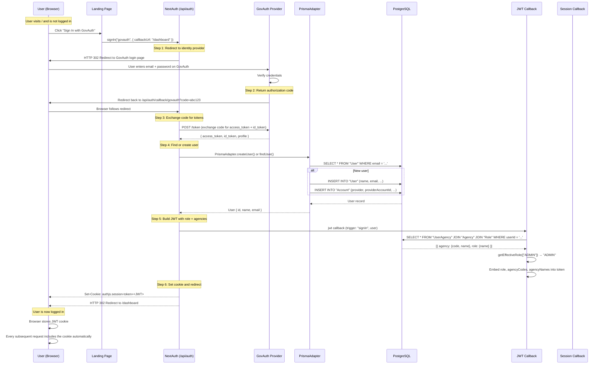

### Step-by-step explanation:

**Step 1 — Redirect to GovAuth:** When you click "Sign In with GovAuth," NextAuth constructs a URL to GovAuth's login page and redirects you there. The URL includes information like "please send the user back to `/api/auth/callback/govauth` when done."

**Step 2 — User authenticates:** You enter your credentials on GovAuth's page. If correct, GovAuth generates an "authorization code" — a one-time token — and redirects you back to Spectra.

**Step 3 — Token exchange:** NextAuth receives the authorization code and exchanges it for an access token and ID token by making a server-to-server request to GovAuth. This happens on the server — the browser never sees the tokens.

**Step 4 — Find or create user:** The PrismaAdapter checks if a User record with this email already exists in PostgreSQL. If not, it creates one. It also creates an Account record linking the user to the GovAuth provider.

**Step 5 — Build JWT:** The JWT callback runs. It queries the database to find which agencies and roles this user is assigned to. It calls `getEffectiveRole()` to determine the highest-priority role. All of this is embedded into the JWT token.

**Step 6 — Set cookie and redirect:** The JWT is set as an HTTP-only cookie in the browser. The user is redirected to `/dashboard`.

### Relevant files:

| File | What it does |
|---|---|
| `src/auth.ts:20-45` | Configures the GovAuth and Microsoft Entra ID providers |
| `src/auth.ts:68-87` | JWT callback — embeds role and agencies into the token |
| `src/auth.ts:92-99` | Session callback — copies token data into the session object |
| `src/auth.ts:105-110` | Authorized callback — checks if user is logged in for protected routes |
| `src/app/api/auth/[...nextauth]/route.ts` | Exposes NextAuth's HTTP handlers |

## 7.4 How Sessions Work After Login

Once logged in, here's what happens on every page load:

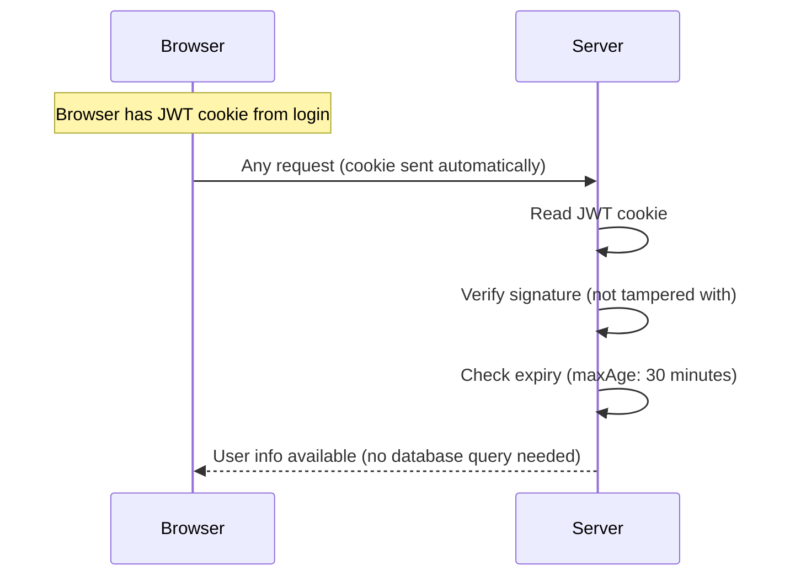

**Key insight:** After login, the server NEVER queries the database to check who you are. Everything it needs (your ID, name, role, agencies) is in the JWT cookie. This is why changing a user's role in the admin panel doesn't take effect until they log in again.

The session expires after **30 minutes** (configured in `src/auth.ts:18`):
```ts
session: { strategy: "jwt", maxAge: 30 * 60 },
```

## 7.5 The Three-Role System

| Role | Priority | What it can do |
|---|---|---|
| **VIEWER** | 1 (lowest) | Read-only access to dashboards scoped to their assigned agencies |
| **EDITOR** | 2 | Same as VIEWER + can modify dashboard configurations (future feature) |
| **ADMIN** | 3 (highest) | Full access — sees all agencies, can manage users/roles via admin panel |

### How role is determined

A user can belong to multiple agencies, each with a different role. For example:
- GOVTECH → ADMIN
- MOE → VIEWER

The `getEffectiveRole()` function picks the **highest-priority** role across all assignments:

```ts
// src/lib/auth-utils.ts:7-14
const ROLE_PRIORITY: Record<string, number> = { ADMIN: 3, EDITOR: 2, VIEWER: 1 };

export function getEffectiveRole(roleNames: string[]): string {
  return roleNames.reduce(
    (best, name) =>
      (ROLE_PRIORITY[name] ?? 0) > (ROLE_PRIORITY[best] ?? 0) ? name : best,
    "VIEWER"
  );
}
```

So if you're ADMIN for ANY agency, you're ADMIN globally (you can see all agencies).

### Where roles are checked

| Location | What it checks | File |
|---|---|---|
| **Proxy/Middleware** | "Is the user logged in?" (coarse check) | `src/proxy.ts` → `src/auth.ts:105-110` |
| **Admin Layout** | "Is the user ADMIN?" (server-side, redirects non-admins) | `src/app/admin/layout.tsx:5-18` |
| **Admin Page** | "Is the user ADMIN?" (client-side, shows error) | `src/app/admin/page.tsx:10-15` |
| **Admin API routes** | `requireRole("ADMIN")` — throws 403 if not | `src/app/api/admin/*/route.ts` |
| **Dashboard API routes** | `authenticateAndScope()` — 401 if not logged in, scopes agencies | `src/app/api/adoption/route.ts` |
| **Navbar** | `useRole().isAdmin` — shows/hides Admin link | `src/components/Navbar.tsx:37-44` |

## 7.6 Agency-Scoped Authorization

This is the most nuanced part of the auth system. Users don't just have a role — they have roles **per agency**.

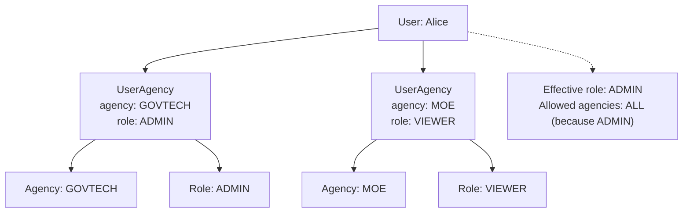

For a non-admin user:
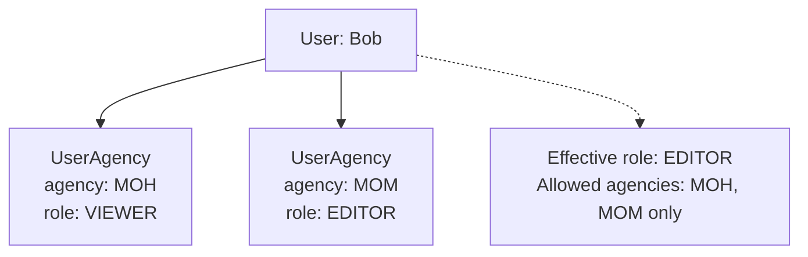

The `authenticateAndScope()` function (`src/lib/auth-utils.ts:36-59`) enforces this:
- ADMINs get `allowedAgencyCodes = null` (meaning "all agencies, no restriction")
- Non-admins get `allowedAgencyCodes = ["MOH", "MOM"]` (only their assigned agencies)
- Every API query is filtered through `scopeAgencies()` to enforce this restriction

## 7.7 What Happens When a Session Expires

1. The JWT cookie's `maxAge` is 30 minutes
2. After 30 minutes of the JWT being created, the cookie expires
3. The next time the browser makes an API request, the server finds no valid cookie
4. The API returns `401 Unauthorized`
5. The `useZoomData` hook catches this: `if (res.status === 401) throw new Error("Your session has expired...")`
6. The user sees an error message telling them to log in again

## 7.8 Logout Flow

```mermaid
sequenceDiagram
    participant U as User
    participant NAV as Navbar or UserMenu
    participant NA as NextAuth
    participant B as Browser

    U->>NAV: Click "Sign Out"
    NAV->>NA: signOut({ callbackUrl: "/" })
    NA->>B: Clear JWT cookie (Set-Cookie: ...=; expires=past)
    NA->>U: Redirect to /
    Note over U: User sees Landing Page, no longer authenticated
```

This is done in two places:
- `src/components/Navbar.tsx:63`: `signOut({ callbackUrl: "/" })`
- `src/components/adoption/UserMenu.tsx:92`: `signOut({ callbackUrl: "/" })`

## 7.9 Type Augmentation: How Role Gets Into the Session

By default, NextAuth's `session.user` only has `name`, `email`, and `image`. Your project adds `role`, `agencyCodes`, and `agencyNames` using TypeScript declaration merging:

```ts
// src/types/next-auth.d.ts
declare module "next-auth" {
  interface Session {
    user: {
      id: string;
      name?: string | null;
      email?: string | null;
      image?: string | null;
      role: string;              // Added
      agencyCodes: string[];     // Added
      agencyNames: string[];     // Added
    };
  }
}
```

This tells TypeScript: "When I access `session.user.role`, it exists and it's a string." Without this file, TypeScript would complain that `role` doesn't exist on the session user type.

---

# Phase 8: Database Interactions

## 8.1 What is a Relational Database?

**Plain English:** A relational database is like a collection of spreadsheets (called "tables"). Each spreadsheet has columns (field names) and rows (individual records). The "relational" part means tables can reference each other — like one spreadsheet pointing to rows in another.

## 8.2 Key Concepts

| Concept | Plain English | Example |
|---|---|---|
| **Table** | A spreadsheet with columns and rows | The `User` table stores all users |
| **Row** | A single record in a table | One specific user (Alice) |
| **Column** | A field that every row has | `name`, `email`, `role` |
| **Primary Key** | A unique identifier for each row | `id: "clx9abc123"` — no two rows share this |
| **Foreign Key** | A reference to a row in another table | `UserAgency.userId` points to a `User.id` |
| **Relationship** | How tables connect to each other | A User HAS MANY UserAgency records |
| **Schema** | The blueprint defining all tables, columns, and relationships | `prisma/schema.prisma` |

## 8.3 What is Prisma (the ORM)?

**Plain English:** Prisma is a translator between JavaScript and SQL. Instead of writing raw SQL like `SELECT * FROM "User" WHERE email = 'alice@gov.sg'`, you write:

```ts
prisma.user.findUnique({ where: { email: "alice@gov.sg" } })
```

Prisma translates this into the appropriate SQL query, sends it to PostgreSQL, and returns the result as a typed JavaScript object.

### Database Connection

The connection is set up in `src/lib/prisma.ts`:
```ts
import { PrismaClient } from "@/generated/prisma/client";
const globalForPrisma = globalThis as unknown as { prisma: PrismaClient };
const prisma = globalForPrisma.prisma || new PrismaClient();
if (process.env.NODE_ENV !== "production") globalForPrisma.prisma = prisma;
export default prisma;
```

**Why the `globalForPrisma` trick?** During development, Next.js restarts the server frequently (hot reload). Each restart would normally create a NEW database connection, eventually exhausting the connection limit. By storing the client on `globalThis`, the same connection is reused across restarts.

The actual database URL comes from the `DATABASE_URL` environment variable (defined in `.env.local`).

## 8.4 Entity Relationship Diagram

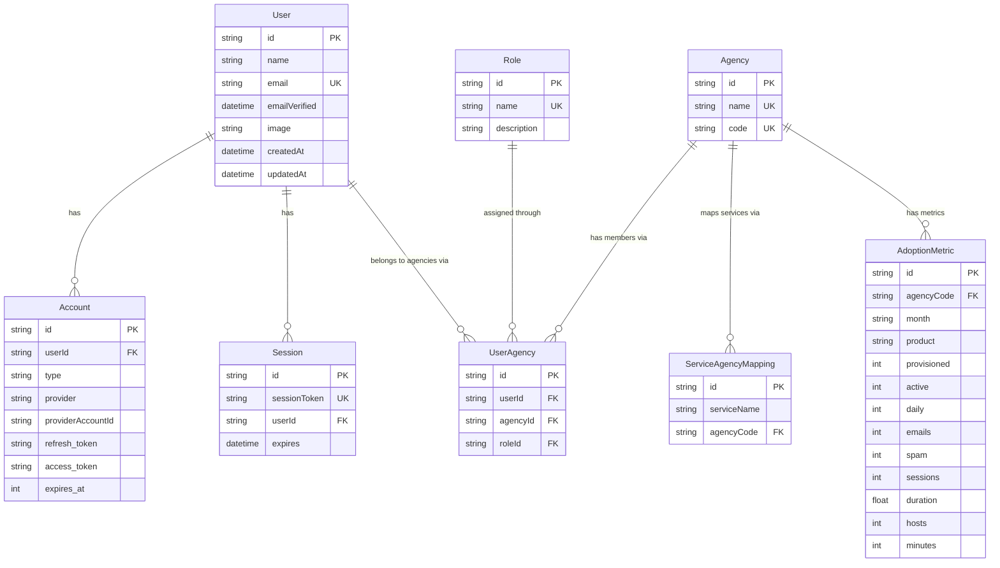

### Table-by-table explanation:

**NextAuth-required tables** (managed by PrismaAdapter):

| Table | Purpose |
|---|---|
| **User** | Every person who has logged in. Created automatically on first login. |
| **Account** | Links a User to an identity provider (GovAuth, Microsoft). A user could have multiple accounts if they log in via different providers. |
| **Session** | Database sessions (not used — this app uses JWT sessions instead, but the table exists for the adapter). |
| **VerificationToken** | Email verification tokens (not used in this app). |

**Application tables** (your business logic):

| Table | Purpose |
|---|---|
| **Role** | Three rows: ADMIN, EDITOR, VIEWER. Defines what each role means. |
| **Agency** | Government agencies: GOVTECH, MOE, NEA, etc. Has a `name` and a short `code`. |
| **UserAgency** | The JOIN table that connects Users to Agencies with a specific Role. This is how "Alice is ADMIN for GOVTECH" is stored. |
| **ServiceAgencyMapping** | Links service names to agency codes (for the service monitoring feature). |
| **AdoptionMetric** | The main data table. Each row = one agency + one month + one product (exchange/teams/zoom) with metrics like `active`, `sessions`, `hosts`. |

## 8.5 How the Seed Script Works

The database starts empty. The seed script (`prisma/seed.ts`) fills it with sample data:

1. **Creates 3 roles:** ADMIN, EDITOR, VIEWER (using `upsert` — creates if missing, updates if exists)
2. **Creates 10 agencies:** GOVTECH, MOE, NEA, ESG, EDB, IMDA, CSIT, MOH, MOF, MOM
3. **Generates adoption metrics:** For each of the 10 agencies × 15 months × 3 products = **450 rows** of deterministic sample data

The data generation uses mathematical formulas (sine waves, modular arithmetic) to produce realistic-looking numbers that are the same every time you run the seed.

Run it with: `npx prisma db seed`

## 8.6 CRUD Operations in the Codebase

### CREATE

**Creating a new service-agency mapping** (`src/app/api/admin/service-mappings/route.ts:25-50`):
```ts
const mapping = await prisma.serviceAgencyMapping.create({
  data: {
    serviceName: body.serviceName,
    agencyCode: body.agencyCode,
  },
  include: { agency: true },
});
```
- `prisma.serviceAgencyMapping.create()` inserts a new row
- `data: {...}` specifies the column values
- `include: { agency: true }` also fetches the related Agency record in the same query

### READ

**Reading adoption metrics** (`src/lib/repositories/postgres-adoption-repository.ts:45-55`):
```ts
private async fetchMetrics(months: string[], agencyCodes: string[]): Promise<MetricRow[]> {
  if (agencyCodes.length === 0) return [];
  const where = {
    month: { in: months },
    agencyCode: { in: agencyCodes },
  };
  return prisma.adoptionMetric.findMany({ where }) as Promise<MetricRow[]>;
}
```
- `prisma.adoptionMetric.findMany()` returns multiple rows
- `where: { month: { in: months } }` means "WHERE month IN ('2026-09', '2026-10', ...)"
- This translates to: `SELECT * FROM "AdoptionMetric" WHERE month IN (...) AND "agencyCode" IN (...)`

**Reading a single user with relationships** (`src/auth.ts:75-79`):
```ts
const dbUser = await prisma.user.findUnique({
  where: { id: user?.id ?? token.sub! },
  include: {
    agencies: { include: { agency: true, role: true } },
  },
});
```
- `findUnique()` returns one row (or null)
- `include: { agencies: { include: { agency: true, role: true } } }` — loads the user's UserAgency records, AND for each one, loads the related Agency and Role. This is like a SQL JOIN.

### UPDATE

**Updating a user's agency assignments** (`src/app/api/admin/users/[id]/route.ts:13-24`):
```ts
// Step 1: Delete all existing assignments
await prisma.userAgency.deleteMany({ where: { userId: id } });

// Step 2: Create new assignments
if (body.agencies.length > 0) {
  await prisma.userAgency.createMany({
    data: body.agencies.map((a) => ({
      userId: id,
      agencyId: a.agencyId,
      roleId: a.roleId,
    })),
  });
}
```
- This is a "replace all" pattern: delete everything old, insert everything new
- `createMany()` inserts multiple rows in one query (efficient)

### DELETE

**Deleting a service-agency mapping** (`src/app/api/admin/service-mappings/route.ts:52-63`):
```ts
await prisma.serviceAgencyMapping.delete({ where: { id } });
```
- Deletes exactly one row by its primary key

## 8.7 Database Query Flow

Here's a complete trace from user action to database and back:

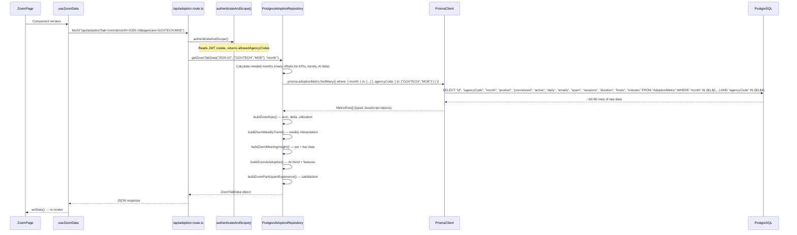

**Key observation:** The repository makes exactly ONE database query (`findMany`), fetching all needed months and agencies at once. All the aggregation (sums, deltas, percentages, trend lines) happens in JavaScript, not in SQL. This is a design choice — it trades slightly more data transfer for simpler queries.

---

# Phase 9: Complete User Workflows

## Workflow 1: First-Time Login

**What the user does:** Visits the app for the first time and clicks "Sign In with GovAuth."

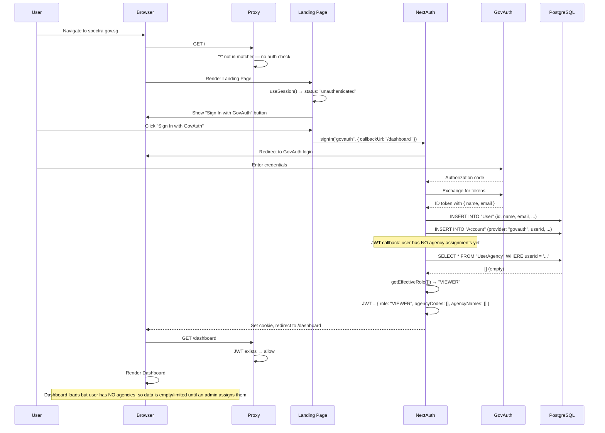

**Files involved:**
| Step | File |
|---|---|
| Landing page render | `src/app/page.tsx` |
| Sign-in trigger | `src/app/page.tsx:41` — `signIn("govauth", ...)` |
| OAuth flow | `src/app/api/auth/[...nextauth]/route.ts` → `src/auth.ts` |
| User creation | PrismaAdapter (automatic) |
| JWT building | `src/auth.ts:68-87` |
| Proxy check | `src/proxy.ts` |

## Workflow 2: Viewing Zoom Dashboard with Filters

**What the user does:** Opens the dashboard, then changes the month to September and deselects some agencies.

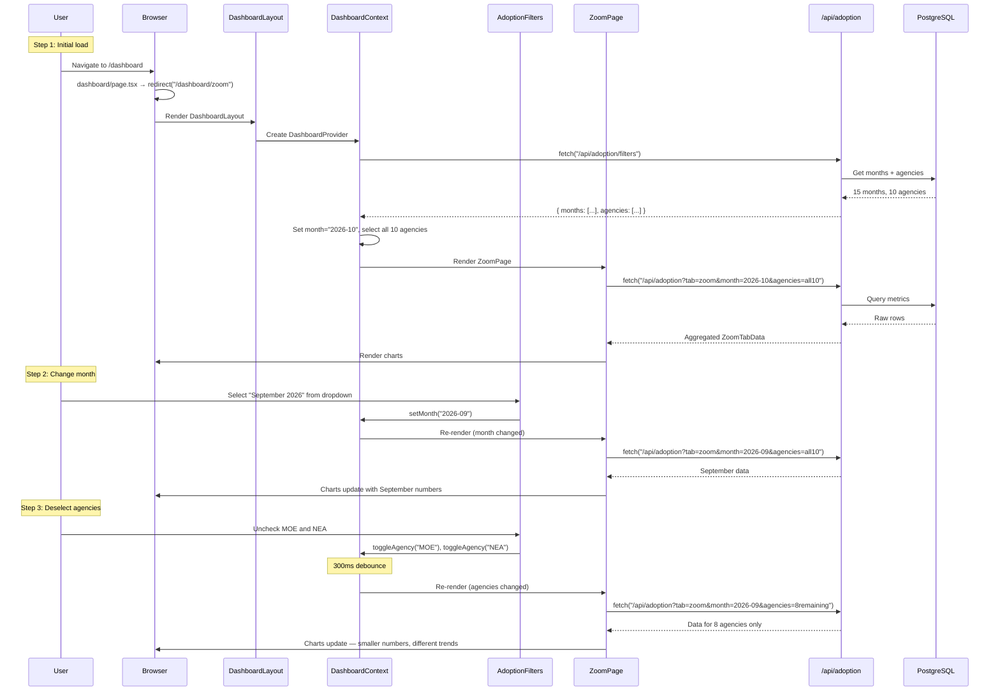

**Files involved:**
| Step | File |
|---|---|
| Redirect to /zoom | `src/app/dashboard/page.tsx` |
| Layout + context | `src/app/dashboard/layout.tsx` |
| Filter fetch | `src/hooks/useAdoptionData.ts:133-157` |
| State management | `src/components/adoption/DashboardContext.tsx` |
| Month dropdown | `src/components/adoption/AdoptionFilters.tsx:83-90` |
| Agency toggle | `src/components/adoption/AdoptionFilters.tsx:126-133` |
| Data fetch | `src/hooks/useAdoptionData.ts:85-131` |
| Server handler | `src/app/api/adoption/route.ts` |
| DB query + aggregation | `src/lib/repositories/postgres-adoption-repository.ts` |

## Workflow 3: Switching Between Monthly and Quarterly View

**What the user does:** Toggles the period mode from "Month" to "Quarter" on the Zoom tab.

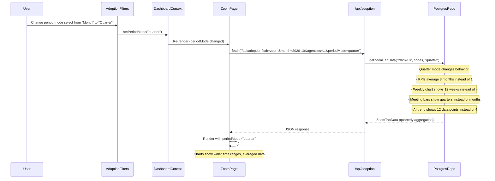

The key difference is in `reportingStep()` (`src/lib/repositories/date-utils.ts:27-29`):
```ts
export function reportingStep(periodMode: PeriodMode): number {
  return periodMode === "quarter" ? 3 : 1;
}
```
When `periodMode` is `"quarter"`, the step between periods is 3 months instead of 1. This affects how deltas are calculated (comparing to 3 months ago instead of 1) and how many data points appear in charts.

## Workflow 4: Hovering Over a Chart

**What the user does:** Moves their mouse over the weekly trend line chart.

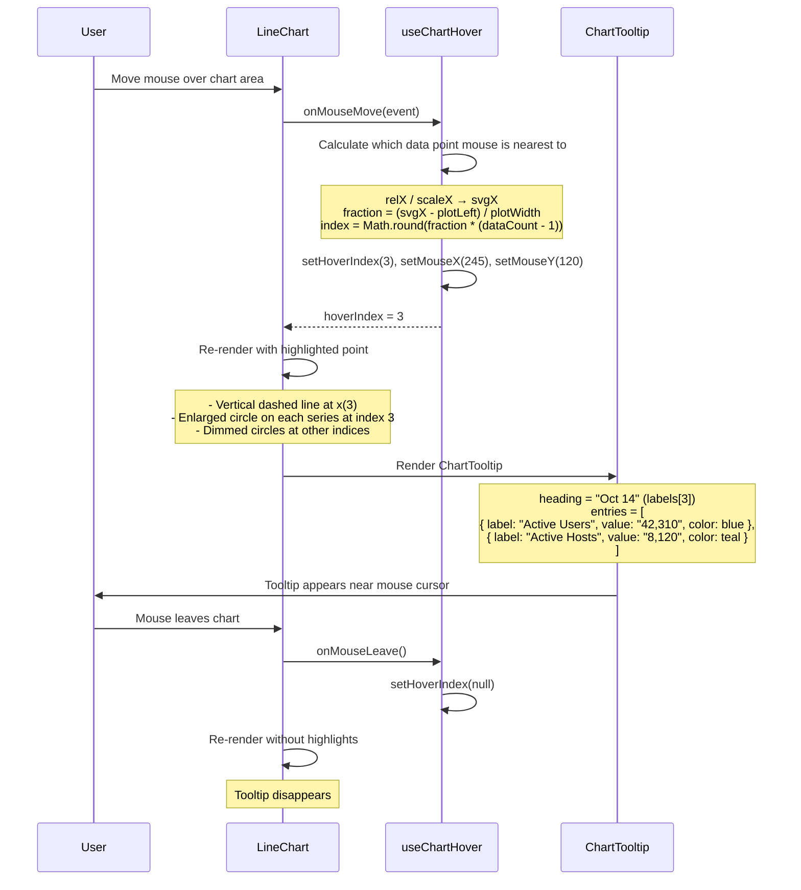

**Files involved:**
| Step | File |
|---|---|
| Mouse tracking | `src/hooks/useChartHover.ts` |
| Chart rendering | `src/components/charts/LineChart.tsx` |
| Tooltip display | `src/components/charts/ChartTooltip.tsx` |

The tooltip flips sides when the mouse is past 65% of the chart width (`src/components/charts/ChartTooltip.tsx:29`):
```ts
const flipSide = x > containerWidth * 0.65;
```

## Workflow 5: Admin Updates a User's Agency Assignments

**What the user does:** An admin assigns a user to new agencies with specific roles. (The admin panel UI is a placeholder, but the API is fully implemented.)

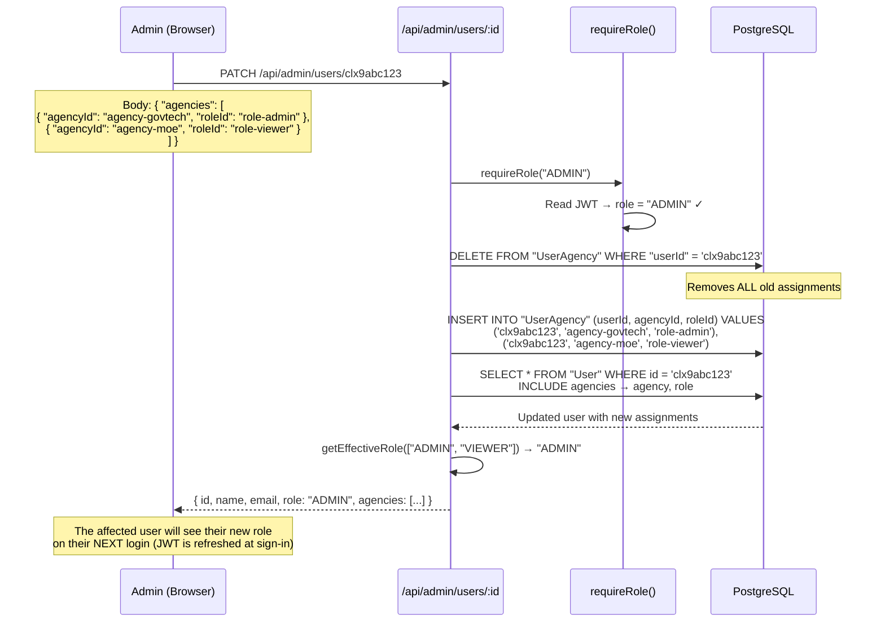

**Important:** The affected user's JWT cookie still contains their OLD role until they log in again. This is because the JWT is created at sign-in time and not refreshed on every request (a deliberate performance tradeoff documented in `src/auth.ts:63-67`).

---

# Phase 10: Debugging and Modification Guide

## 10.1 How to Find the Code for a UI Element

**Scenario:** You see a KPI card showing "Active Users: 42.3K" and want to find the code that renders it.

**Method 1 — Work backwards from the URL:**
1. You're at `/dashboard/zoom` → file is `src/app/dashboard/zoom/page.tsx`
2. ZoomPage renders `<ZoomTabContent>` → file is `src/components/adoption/ZoomTabContent.tsx`
3. ZoomTabContent renders `<ZoomKpiCards>` → file is `src/components/adoption/ZoomKpiCards.tsx`
4. Found it — `ZoomKpiCards` renders the KPI cards

**Method 2 — Search for visible text:**
```bash
grep -r "Active Users" src/components/
```
This finds every file containing the text "Active Users."

**Method 3 — Search for a CSS class (from browser dev tools):**
1. Right-click the element in the browser → "Inspect"
2. Note the CSS class, e.g., `sa-kpi-value`
3. Search: `grep -r "sa-kpi-value" src/`
4. This finds both the component using it and the CSS file defining it

## 10.2 How to Trace a Function Call

**Scenario:** You want to understand where `getEffectiveRole()` is used.

```bash
grep -rn "getEffectiveRole" src/
```

Output:
```
src/lib/auth-utils.ts:9:  export function getEffectiveRole(roleNames: string[]): string {
src/auth.ts:82:           token.role = getEffectiveRole(assignments.map((ua) => ua.role.name));
src/app/api/admin/users/route.ts:44:   role: getEffectiveRole(u.agencies.map((ua) => ua.role.name)),
src/app/api/admin/users/[id]/route.ts:37: role: getEffectiveRole(user!.agencies.map((ua) => ua.role.name)),
```

Now you know:
- It's **defined** in `auth-utils.ts:9`
- It's **called** in the JWT callback (`auth.ts:82`), user list API (`users/route.ts:44`), and user update API (`users/[id]/route.ts:37`)

## 10.3 How to Follow Imports

Every file starts with `import` statements that tell you its dependencies:

```ts
// src/app/dashboard/zoom/page.tsx
import { useDashboard } from "@/components/adoption/DashboardContext";
import { useZoomData } from "@/hooks/useAdoptionData";
import ZoomTabContent from "@/components/adoption/ZoomTabContent";
import LoadingSpinner from "@/components/LoadingSpinner";
import ErrorDisplay from "@/components/ErrorDisplay";
```

Read these as: "This file depends on DashboardContext, useAdoptionData, ZoomTabContent, LoadingSpinner, and ErrorDisplay."

Remember: `@/` means `./src/` (configured in `tsconfig.json:22`).

## 10.4 How to Find an API's Handler

**Scenario:** The browser calls `fetch("/api/adoption?tab=zoom&month=2026-10")`. Where does the server handle this?

**Rule:** The URL path maps directly to the folder structure under `src/app/api/`:
- `/api/adoption` → `src/app/api/adoption/route.ts`
- `/api/adoption/filters` → `src/app/api/adoption/filters/route.ts`
- `/api/admin/users` → `src/app/api/admin/users/route.ts`
- `/api/admin/users/abc123` → `src/app/api/admin/users/[id]/route.ts`

The `route.ts` file exports functions named after HTTP methods:
- `export const GET = ...` handles GET requests
- `export const POST = ...` handles POST requests
- `export const PATCH = ...` handles PATCH requests
- `export const DELETE = ...` handles DELETE requests

## 10.5 How to Use `console.log` for Debugging

**Client-side (browser):** Add `console.log()` in any Client Component. Output appears in the browser's Developer Tools → Console tab.

```tsx
// In src/hooks/useAdoptionData.ts
const fetchData = useCallback(async () => {
  console.log("Fetching with month:", month, "agencies:", agencyCodes);
  const res = await fetch(`/api/adoption?...`);
  const json = await res.json();
  console.log("Received data:", json);
  // ...
});
```

**Server-side:** Add `console.log()` in API routes or server utilities. Output appears in the terminal where `npm run dev` is running.

```ts
// In src/app/api/adoption/route.ts
export const GET = withErrorHandling(async (request) => {
  console.log("API hit:", request.url);
  const { allowedAgencyCodes } = await authenticateAndScope();
  console.log("Allowed agencies:", allowedAgencyCodes);
  // ...
});
```

## 10.6 How to Use Browser Developer Tools

1. **Open DevTools:** Press `F12` or `Cmd+Option+I` (Mac)
2. **Network tab:** Shows every HTTP request the browser makes
   - Click a request to see its URL, method, headers, request body, and response body
   - Filter by "Fetch/XHR" to see only API calls
   - Look for `/api/adoption` requests to see what data the server returns
3. **Console tab:** Shows `console.log` output and JavaScript errors
4. **Application tab → Cookies:** Shows the `authjs.session-token` JWT cookie

## 10.7 Common Error Types and Where to Look

| Error | Where to Look | Likely Cause |
|---|---|---|
| Page shows spinner forever | Network tab → is the API call stuck? | Server not running, or database down |
| "Your session has expired" | The API returned 401 | JWT cookie expired (30 min). Log in again. |
| "Insufficient permissions" | API returned 403 | User role doesn't match `requireRole()` check |
| "No agencies assigned" | API returned 403 | User has no UserAgency records. Admin needs to assign them. |
| Charts show no data | Check API response in Network tab | Agency filter is empty, or no metric data for selected month |
| "Failed to fetch" | Console tab for error details | API URL wrong, server crashed, or CORS issue |
| TypeScript error: "Property X does not exist" | The file with the red underline | The type definition doesn't include that property. Check `src/types/` |
| "Hydration mismatch" | Console tab | Server-rendered HTML doesn't match browser-rendered HTML. Often caused by using `Date` or `Math.random()` during render |
| Admin page redirects to /dashboard | You're not ADMIN | `admin/layout.tsx` checks `session.user.role !== "ADMIN"` |

## 10.8 How to Distinguish Frontend, Backend, and Database Errors

```
User clicks something
    │
    ├─ Nothing happens → FRONTEND issue
    │   Check: Browser console for JavaScript errors
    │   Check: Is the event handler wired up? (onClick, onChange)
    │
    ├─ Spinner appears but never stops → API issue
    │   Check: Network tab — did the request go out?
    │   Check: Network tab — is the response pending?
    │   Check: Terminal — server error logs
    │
    ├─ Error message appears → Check the error text
    │   "session has expired" → AUTH issue (re-login)
    │   "Insufficient permissions" → AUTHORIZATION issue (wrong role)
    │   "Internal server error" → BACKEND issue
    │       Check: Terminal for stack trace
    │       Check: Is the database running?
    │
    └─ Wrong data appears → DATA issue
        Check: API response in Network tab — is the data correct?
        If API data is correct → FRONTEND rendering issue
        If API data is wrong → BACKEND aggregation issue
            Check: Database directly — is the raw data correct?
```

## 10.9 Understanding TypeScript Errors

Common TypeScript errors you'll see:

**"Property 'role' does not exist on type 'User'"**
- The type definition doesn't include `role`
- Fix: Check `src/types/next-auth.d.ts` — the type augmentation might be missing

**"Type 'string' is not assignable to type 'PeriodMode'"**
- You're passing a generic string where a specific union type is expected
- Fix: Cast it: `(value as PeriodMode)` or use a type guard

**"Object is possibly 'undefined'"**
- TypeScript warns that something might not exist
- Fix: Add a null check (`if (data) { ... }`) or use optional chaining (`data?.field`)

**"Argument of type 'X' is not assignable to parameter of type 'Y'"**
- You're passing the wrong shape of data to a function
- Fix: Compare the actual data shape to what the function expects (hover over the function name to see its type)

## 10.10 Example: Safely Modifying a Feature

**Scenario:** You want to change the session expiry from 30 minutes to 1 hour.

**Step 1 — Find the code:**
```bash
grep -rn "maxAge" src/
```
Result: `src/auth.ts:18: session: { strategy: "jwt", maxAge: 30 * 60 },`

**Step 2 — Understand what it does:**
- `maxAge: 30 * 60` = 1800 seconds = 30 minutes
- This controls how long the JWT cookie is valid

**Step 3 — Identify what would change:**
- Users stay logged in for 60 minutes instead of 30
- No other files need to change — this is the single source of truth for session duration

**Step 4 — Make the change:**
Change `30 * 60` to `60 * 60` in `src/auth.ts:18`

**Step 5 — Verify it works:**
1. Restart the dev server (`npm run dev`)
2. Log in
3. Open DevTools → Application → Cookies
4. Check the cookie's expiry time — it should now be ~60 minutes from now

**Step 6 — Test edge cases:**
- Does logout still work? (Sign out, verify cookie is cleared)
- Does the session callback still run correctly? (Check that role/agencies still appear)

---

## Summary: Complete Application Knowledge Map

```
┌─────────────────────────────────────────────────────────────────┐
│                         SPECTRA POC                             │
├─────────────────────────────────────────────────────────────────┤
│                                                                 │
│  AUTHENTICATION (Phase 7)                                       │
│  ├── GovAuth / Microsoft Entra ID (identity providers)          │
│  ├── NextAuth v5 (orchestrator)                                 │
│  ├── JWT cookies (session storage)                              │
│  ├── Per-agency role system (ADMIN > EDITOR > VIEWER)           │
│  └── Agency scoping (non-admins see only their agencies)        │
│                                                                 │
│  DATABASE (Phase 8)                                             │
│  ├── PostgreSQL (relational database)                           │
│  ├── Prisma ORM (JavaScript → SQL translation)                  │
│  ├── 10 tables (User, Account, Role, Agency, UserAgency,        │
│  │   ServiceAgencyMapping, AdoptionMetric, Session, etc.)       │
│  └── Seed script (generates deterministic sample data)          │
│                                                                 │
│  FRONTEND (Phases 2, 4)                                         │
│  ├── Next.js App Router (folder = URL)                          │
│  ├── React Client Components (interactive UI)                   │
│  ├── DashboardContext (shared state)                             │
│  ├── Custom hooks (useZoomData, useAdoptionFilters)             │
│  └── SVG chart components (LineChart, PieChart, StackedBar)     │
│                                                                 │
│  BACKEND (Phases 5, 6)                                          │
│  ├── API Route Handlers (/api/adoption, /api/admin/*)           │
│  ├── Repository Pattern (Postgres ↔ Databricks)                 │
│  ├── Server-side aggregation (sums, deltas, trends)             │
│  └── Error handling (withErrorHandling wrapper)                  │
│                                                                 │
│  KEY WORKFLOWS (Phase 9)                                        │
│  ├── Login → OAuth → JWT → cookie → dashboard                   │
│  ├── Dashboard load → filters API → data API → render charts    │
│  ├── Filter change → debounce → re-fetch → re-render            │
│  ├── Chart hover → useChartHover → tooltip                      │
│  └── Admin assign → delete old → create new → affects next login│
│                                                                 │
│  DEBUGGING (Phase 10)                                           │
│  ├── URL → folder path → page/route file                        │
│  ├── grep for text, functions, CSS classes                       │
│  ├── Network tab for API requests/responses                     │
│  ├── Console tab for JavaScript errors                          │
│  └── Terminal for server-side errors                             │
│                                                                 │
└─────────────────────────────────────────────────────────────────┘
```

---

*End of Complete Learning Guide — Phases 1–10.*
